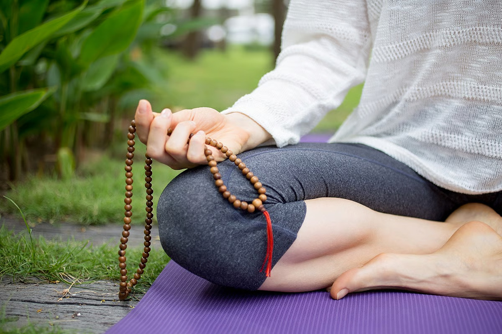

# Bharat’s future and your big role in it

*By Brahmarshi Acharya Upendra Ji · 2026-06-24T03:30:00+00:00 · Source: https://blogs.antaryogfoundation.in/bharats-future-and-your-big-role-in-it/*

What is the real meaning of spirituality? Is being religious and spiritual the same? Religion i.e. Dharma is any action done repeatedly with a sense of responsibility whereas spirituality is knowing the spirit, the life force, which keeps us alive. Once you start inquiring about ‘who am I’, and ‘what’s the purpose of my life’, spirituality begins in the true sense.

For ages, religion has been widely followed in our country. Traditional rituals like havan, yajna, puja, daan, etc, are performed in almost every household and temple. Despite so much faith, devotion and rituals, why does India rank low on the world happiness index? Why do we have growing unemployment, poverty, divorce cases, corruption, addiction, diseases, high depression rates and ever-increasing inflation leading to a stressful and unhappy life?

Despite remarkable medical advancements and numerous vaccines, pandemics and other diseases are still growing. There are inventions for ultra-luxury lifestyles, yet these comforts are not able to give you happiness and peace. You can buy a costly bed, but can it guarantee you good quality of sleep?

Businesses are making endless products to serve your never-ending desires, but these products cannot give you real happiness that will last forever. Entertainers are releasing thousands of films, they are not able to spread wisdom and motivate you to do higher things. Politicians are tightening law and order, but are not able to reduce crime rates and injustice. All of these boil down to one question — where are we going wrong?

On a personal level, ask yourself if you have understood the real meaning of Dharma?

Dharma is doing your duties as defined in our ancient scriptures and by spiritual Gurus, happily, till the last breath. Since you haven’t studied scriptures well, you do not know your duties and are stuck to the limited ideas of religion. You consider doing various rituals, murti puja, and going to the temple as the final step. But you are not able to see the same lord in the form of your in-laws, relatives, boss, etc.? Hence your idea of religion is not helping you to go beyond caste, creed, religion or status and learn to love unconditionally with oneness as Lord Krishna states in Bhagavad Gita. This is the path towards real spirituality, which is missing today!

Spirituality, the backbone of our country, is an absolute necessity today. But this can’t be understood just by knowing science because it doesn’t hold the power to unfold the deeper science of spirituality. One has to go beyond logic to realise the truth. As Krishna says in Bhagavad Gita, chapter 9, verse 1: ज्ञानं विज्ञानसहितं (spiritual wisdom and scientific knowledge to be learnt together). We need spiritual masters adapting and teaching the ‘science of spirituality’ to students and shaping them into masters and leaders of tomorrow.

The time has come to evolve higher. This is why, along with me, thousands are working towards realising this goal. Within a decade, you will witness major changes in our country, uplifting it from a developing nation to a Superpower, a Vishwa Guru.

Here is the picture of Bharat of your dreams, which is the destiny of Bharat as I can clearly see and is going to become a reality in a decade. The children and youth of our country will become a part of the Guru-Shishya tradition as the character-building Gurukul education system of Bharat will be restored. While receiving the highest quality of spiritual and worldly knowledge under a Guru, the students will lead a righteous life. They will rise above materialistic goals and will work towards the progress of the country.

A fearless king, like Shivaji Maharaj and Chandragupta Maurya, who were able to take strong decisions for the welfare of the country and its people, will be chosen under the guidance of a spiritual master, who will purely be an administrator and not a businessman. His laws will be strict, eradicating the malpractices in our nation.

The powerful armed forces of our country will also be deeply rooted in spirituality. They will diligently follow the principle of the shastras: “Do not scare others but don’t let anyone scare you either.” Due to our strong and fearless attitude, no nation would dare to disturb our borders and our lives.

Corruption in the police and judicial system will end as they will realise the terrible consequences of bad karma. With the help of their intuitive powers, judges will be able to give the correct verdict and will not be manipulated by lawyers. Today, the good people live in fear, but due to the transformations in these systems, tomorrow the wrongdoers will be fearful.

Medical practices will work in conjunction with ancient spiritual healing practices which will also be an integral part of the syllabus. During diagnosis, along with asking their patients “What food did you eat?”, doctors will also question “What sins have you committed in your life?”

Seeing all beings as an extension of the self, citizens will consciously choose a vegetarian diet and experience sound health. Every citizen of our country will start celebrating our festivals by understanding the deep, symbolic significance behind them, eradicating blind faith and sole focus on idol worship.

Women, the strength of our country will learn Vedant and rise to powerful positions and lead the world. They will no longer function emotionally and will take all decisions practically. They will nurture a strong, spiritual and visionary generation.

The elderly citizens will be treated with respect and love by their families, eliminating the need for old-age homes. Relations will be fostered with happiness, love and care by seeing Lord in every individual. Divorce rates would be negligible and family disputes will stay far away from court.

Businessmen will strictly abide by ethical trade practices by learning the principles of Shree Vidya and Arthashastra. Everyone will pay taxes diligently, accepting it as their responsibility.

The youth of this country will be iron-willed, revolutionary, powerful individuals with higher goals for the nation and the world. Most of them will shift from employee mindset to entrepreneurial mindset. Brain drain will reduce. The West we follow today will be our followers tomorrow. They will be the ones waiting in lines to come to Bharat. The youth will follow brahmacharya and will be loyal and faithful to their partner.

All forms of entertainment will be created with an aim to spread some spiritual, social, and motivational message which will benefit society at large. This Way of Life will be followed by every citizen, which will make them healthy, wealthy, and spiritual and strengthen their relations. They will realise their responsibilities towards their country and contribute in every field to uplift Bharat.

Today, the definition of a superpower equates to a nation, which has nuclear weapons in its armour and has the power of mass destruction. But with everyone learning Advaita Vedanta, the highest spiritual philosophy, which preaches the principle of non-duality and instils a sense of oneness; the definition of superpower is going to change to a nation which can hold the world together with love. And, that nation is going to be our own Bharat.

The task of being a superpower and a world leader is huge and will take remarkable sacrifices. It needs a serious commitment of our countrymen to contribute to uplifting our nation under the guidance of competent spiritual gurus. Pursuing a 9 to 5 job and living a life with ordinary goals for ‘me and my family’ will not make us a superpower. Imagine, if our freedom fighters would have been in search of a 9 to 5 job, would our country be free today?

Turning towards spirituality is not an option but the need of the hour. Due to hundreds of years of slavery that we have endured, we are heavily influenced by the western world. This has changed our attitudes from being leaders to merely being blind followers. It is high time to restore everything that we have lost.

The time has come to unite as a nation under a spiritual Guru, be fuelled by spirituality to be invincible. Then within a decade, you will see the world following us and Bharat emerging as a world leader, a Vishwa Guru once again in all its glory!
