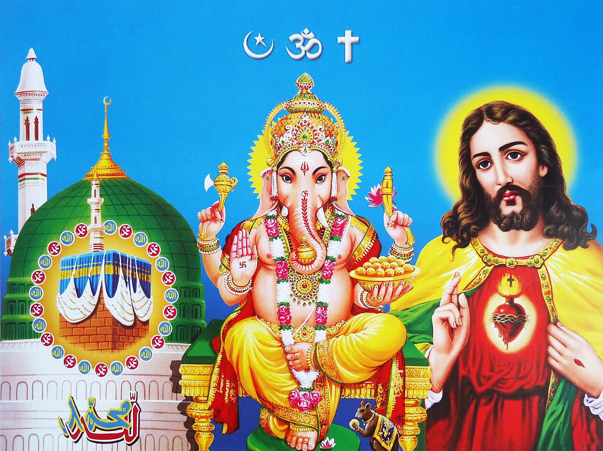

# Do multiple forms of gods and goddesses exist in other religions apart from Hindu? Read on to find out more

*By Brahmarshi Acharya Upendra Ji · 2026-04-22T04:03:19+00:00 · Source: https://blogs.antaryogfoundation.in/do-multiple-forms-of-gods-and-goddesses-exist-in-other-religions-apart-from-hindu-read-on-to-find-out-more/*

In the previous article of our series, we looked into the concept of 33 Koti devatas in the Hindu religion and understood that they are manifestations of the same infinite, formless God, each having a specific quality, power and purpose. Now you may question, do only Hindus have multiple forms of God? Or do other religions also have this concept of multiple forms?

In this article, let me show you how this idea of multiple forms of Gods is common in all religions which exist worldwide.

The Greeks are known to have multiple Gods and Goddesses for every aspect of their lives each having a different purpose. For example, Zeus is the chief Greek deity and is considered as the ruler, protector, and King of all Gods and humans. Apollo is the God of the Sun, music, poetry and healing. Hera is the queen of the Gods and represents an ideal woman, the goddess of marriage and family.

Similarly, Christians have archangels, angels, and saints to whom they pray. Psalm 148:2-5 mentions about angels. The Roman Catholic Church has so far recognised more than 10,000 saints and they are worshipped for different purposes. Saint Christopher is the patron of travellers, he protects people in their travels and against sudden death. Saint Valentine is the patron of love and happy marriages. Saint Maria Goretti is the patroness of forgiveness. Christians even celebrate the feast day of saints in Church.

Islam also has archangels and angels. Quran ayat 2.98 mentions Angel Jibril. He is known as the Angel of Revelation as he played an essential role in communicating Islam to Prophet Muhammad and the entire mankind. Angel Mika’il, the Angel of Mercy, is known as the giver of rain and food. Angel Izrail, the Angel of Death, helps the parting soul from the body of a dead person and carries the soul to heaven or hell.

So, this idea of multiple forms of one God is common in all religions. Hinduism also has one God, but people treat the different forms also as Gods and Goddesses. Let me give you an example to clarify this further. You address the King of the country as ‘Sir’ with respect. If you are facing a water shortage at home frequently, you approach your local corporator. You address him also as ‘Sir’. He has the power to resolve your issue and hence has special importance. But does it mean he has an equal position as that of the King?

Right from the King, to the cabinet of ministers till the corporators, you respect everyone and address them as ‘Sir’. But does that mean all are of equal position as the King? Does it mean we have thousands of Kings? No. There is only one King of the country. Similarly, in Sanatan Dharma each devata is given equal respect and importance as the supreme God. But the real problem arises when you start thinking that every devata is the same and equal as the infinite supreme God.

To avoid this difficult situation, many religions have the system of one God and treat the multiple forms of God as angels, archangels, saints, etc. But, this idea that God and saints, archangels, angels are separate also leads to a misunderstanding. Because, ultimately the angels, archangels, saints, etc. are manifestations of the same supreme God.

The multiple forms of God are expressed to us through idols, symbols, paintings, etc. Churches have a cross and an idol of Jesus. The holiest city in Islam, Mecca has the sacred Kaaba, the black stone. The crescent moon and star are their holy signs. Flowers and chadar are also offered as a form of devotion in dargahs. The act of circumambulation or pradakshina is also common in many religions.

All great revered saints and legends in our history are introduced to us through their idols or photos. Without their idols or photos, how would we have known about them? Or how would we introduce them to our future generations? Some followers of Buddhism are of the opinion that an idol need not be worshipped. But still, Buddhist temples, stupas, and monasteries have an idol of Buddha. It is through symbols and idols that our future generations will know Buddha. If an idol, a painting or a photo of Shivaji Maharaj was never made, how would we know about him and relate to the stories of his bravery? This is how great saints, legends and their teachings live with us and will continue to inspire our coming generations and remain immortal in the world.

Each one of you needs a physical form of God to bow down your heads, pray, seek blessings, speak out your mind and express your devotion, be it a photo, a symbol or an idol, etc. Hence, the concept of multiple forms of God was never just limited to one religion, but in fact common in all religions and originated from the times of the early man when religion did not even exist.

From the past articles in this series, you have gained real wisdom about God and his multiple forms. Let us look at the ‘ideal’ way of idol worship and the deep hidden science behind it in the next article.
