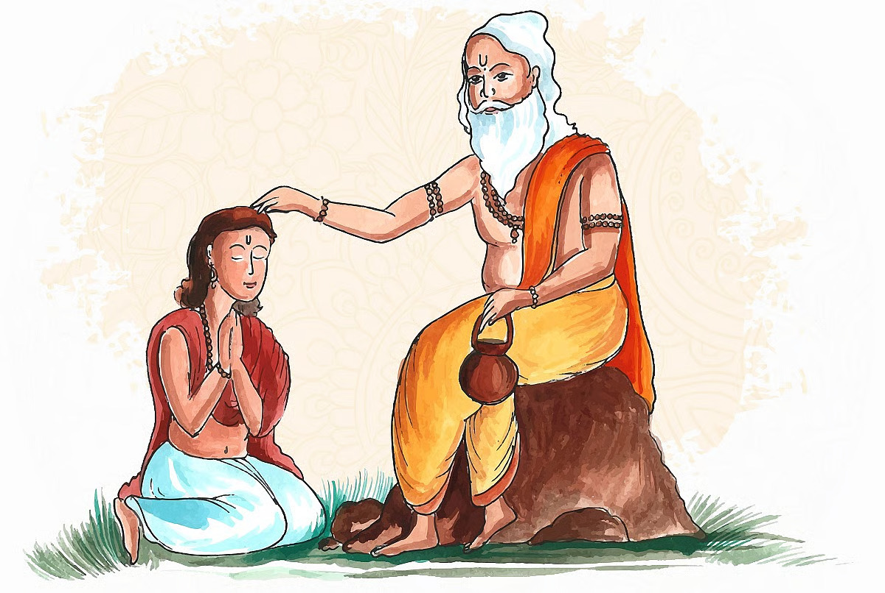

# Guru Gyan: Who is a real Guru?

*By Brahmarshi Acharya Upendra Ji · 2026-06-07T03:30:00+00:00 · Source: https://blogs.antaryogfoundation.in/guru-gyan-who-is-a-real-guru/*

What is your idea of a Guru? Is Guru someone with just a huge number of devotees? Or one who performs miracles? Is he someone wearing coloured robes who gives you a mantra or a gemstone to ease your sufferings in a minute? Most of you even might have tried these remedies, but did they put an end to your problems? In the course of going to many gurus and trying multiple remedies, you may lose a lot of wealth, may lose your faith in God and Guru or end up being blind followers of the wrong Guru and get stuck.

This brings us to the key question, who is a real Guru? Guru Gita chapter one, verse 33 perfectly describes Guru as the one who dispels the darkness of ignorance with the light of knowledge (gu stands for ‘darkness’ and ru for ‘light’).

In Kaliyug, where many incorrect practices are prevalent, it is very crucial that you are able to correctly identify who is a real Guru. Today, I am sharing with you signs and personality traits of a real Guru. It is imperative to have all these qualities in oneself to be able to be called a real Guru.

When you meet a real Guru, you get a feeling of reaching your destination and your search ends. You realise there is no one else with such spiritual wisdom and divinity elsewhere.

A real guru knows and practices all four paths of Yog — Karma, Bhakti, Dnyan and Dhyan

In the mere presence of such a Guru, all your doubts get answered without the need for asking any questions

In his presence, you experience peace and calmness

A real Guru’s only interest is in your betterment and progress

He is selfless and does not have any expectation of any favours in return

A real Guru takes every step and action in the best interest of his disciples

His company inspires you to work towards higher goals with utmost focus and diligence

His mere presence, sight, teachings, remembrance, etc. will wash off your sins of many births, destroys your evil tendencies (shadripus) and you start acquiring divine qualities

A real Guru does not just seek disciples but creates a force of competent Gurus who can continue to lead his vision after him

Kathopanishad, chapter two, verse eight, states, that you cannot understand your real identity merely by logic, only a real Guru who is both, Shrotriya and Brahmanishtha, can show the seekers the true purpose of human birth, which is to manifest the lord within us.

Shrotriya is the one who has deep knowledge of all spiritual scriptures, is a good orator and can teach you the same, but cannot make you experience it. Just as cricket commentators can do excellent commentary and know all the rules but they may not be great players. Brahmanishtha is the one who has applied this knowledge and experienced Brahman. He can give you experience, but cannot teach and answer your doubts. Your questions and doubts will remain unresolved if you follow only a Brahmanishtha Guru. For instance, a great batsman may not be a good orator and commentator.

But do you think a Guru is just limited to a physical body? No, a Guru is never just limited to a physical form (sakar). You should also be able to see the divine Guru tatva (nirakar), that works through him. Seeing your Guru in a finite form is a limited understanding of his abilities which you will find hard to believe and may make you insult or disobey him. This also makes many seekers egoistic and fight amongst each other over whose Guru is better.

Merely having a real guru does not ensure you will follow the right path. Just like the map’s navigator, no matter how many times you take a wrong turn, the real Guru will keep showing the path to reroute you from the new spot to the original destination of Nar se Narayan. It’s your decision if you want to walk on that path or get hit by roadblocks until you finally make the right choice.

With immense faith and devotion in your Guru, you earn the ability to recognise your inner voice which is nothing but Guru tatva guiding you on the right path and your life becomes blissful.

Now, will you still prefer going to anyone to get easy remedies and get uncertain relief from your problems or set out on the quest to find a real Guru to get permanent freedom from your problems? I am sure now you must have got the correct understanding to check if you have met a real Guru!
