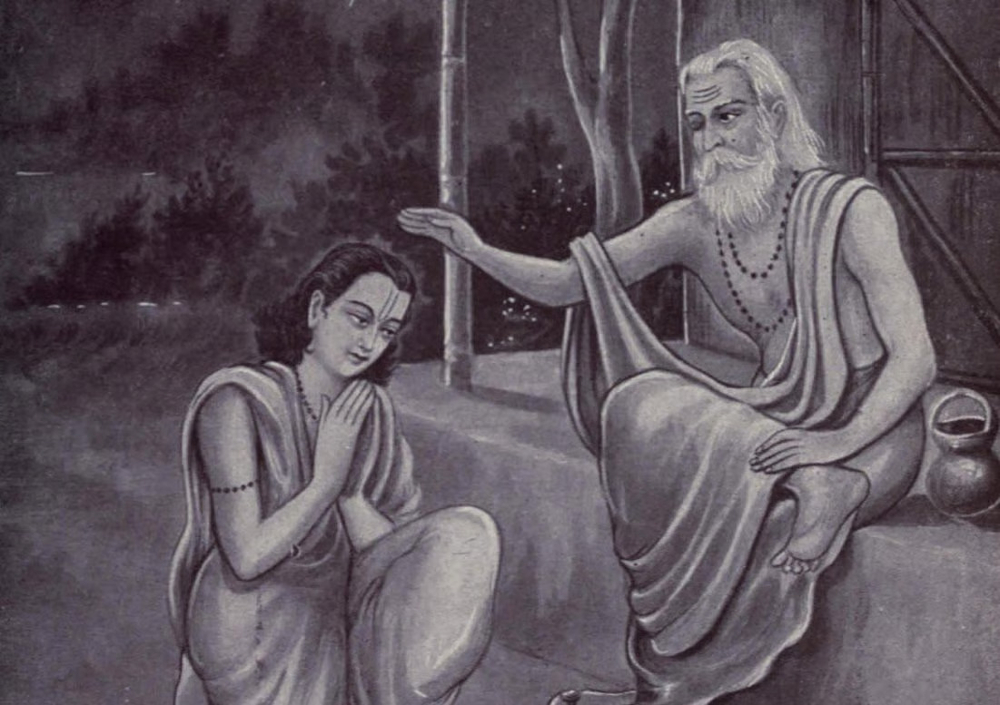

# Guru Purnima special: Why do you need a Guru?

*By Brahmarshi Acharya Upendra Ji · 2026-06-22T03:30:00+00:00 · Source: https://blogs.antaryogfoundation.in/guru-purnima-special-why-do-you-need-a-guru/*

It is said that life is a beautiful journey. But many seem to lose the path and do not find the right way. Do you know where you have come from and where you have to go?

Everyone is trying hard to reach somewhere in life without knowing where exactly they have to head. Most of you think happiness is all about having a perfect job, marrying a beautiful-looking partner, living a luxurious life and accumulating wealth! But, in spite of having everything, you still feel a void inside and long for something higher, something more, isn’t it? This is a never-ending quest. What are we all searching for?

Can one reach the ultimate destination of life independently or we need a Guru to guide us?

Let us understand this with an example. Imagine you plan a road trip to Kolkata. You don’t know how to reach Kolkata, in fact, you are unsure of your present location too. In such a scenario, if you set out on this unchartered journey, what are the chances that you will reach your destination? Almost none! Now if you get a map and are able to identify your starting point and end point, you can easily choose the fastest route that will take you to your destination.

But by just looking at the map would you know about the diversions or roadblocks in between? Or will you know if the road is safe to drive at night or if it has unreachable network coverage and you may get looted by dacoits? Does the map also show adverse weather or road conditions on the way due to which you might meet with an accident?

But, what if you are guided by a navigator all along the way? It will guide you at every turn and signal you about the current traffic conditions. Or if you are travelling with a friend who has already been to your destination, who knows the rough patches on the way, or the best place to halt for refreshments and guides you to take the best route possible. Don’t you think this way, your journey will be hassle-free and more memorable?

The same way, when we talk about the journey of our lives, the maps are nothing but our ancient, timeless scriptures such as Gita, Upanishads, Purans, etc. which act as a guiding principle in our lives and the navigator or the friend is our spiritual Guru who has walked on the path and has been to the destination.

A Guru is capable of foreseeing problems in your life and can guide you perfectly to avert them. But till you become a perfect driver or familiar with the route, you need the help of a map and a navigator i.e our scriptures and a Guru to decode those scriptures and answer the questions the life poses to you.

The truth is that each one of you is born with the programming of going from Nar se Narayan in this birth itself. The goal of life is to manifest the lord within us. That is our real destination. Only a spiritual Guru who has been there, can tell us our real destination, guide us on how to overcome the obstacles on route and show us the way perfectly.

Now, imagine not having a navigator to show you the way on your next road trip. You can easily get lost or stuck on the way you have chosen. Living a life without a Guru is no different. Life becomes a scary roller coaster ride with endless highs and lows, joys and sorrows and you keep complaining as you do not know how to ride it. It is then that most of you turn towards a Guru to seek help, right?

The importance of a spiritual Guru is extraordinary and his place in your life is irreplaceable. Even the great warrior, Arjuna, was led by his Guru Lord Krishna in the epic battle of the Mahabharat. Lord Krishna was his charioteer and the secret to Arjuna’s glorious win, was that Lord Krishna steered his chariot and guided him on the right way for the entirety of the battle. Likewise, when you give the reins of your chariot i.e your life in the hands of a Guru by surrendering to him fully, he guides you at every step you take and saves you from downfalls, sorrows and miseries.

Don’t wait for miracles to happen before you bow down to a Guru. Instead, bow down correctly to your Guru and miracles will follow you. Now, would you still want to navigate your lives blindly, unguided and be hit by several roadblocks or be guided by a Guru and ride on a highway to success, happiness and freedom? The choice is yours!
