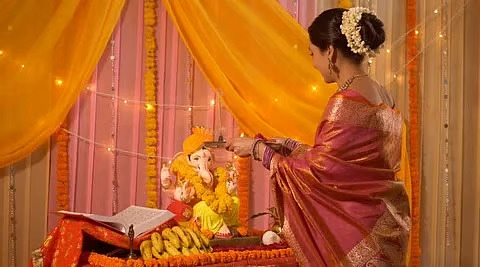

# Her right education is our bright future

*By Brahmarshi Acharya Upendra Ji · 2026-06-18T03:30:00+00:00 · Source: https://blogs.antaryogfoundation.in/her-right-education-is-our-bright-future/*

Despite good education, higher pay scale and top positions at work, it is observed that most women are still treated as secondary to men. Violence against women is still common. If even educated women are not safe today, is academic education alone enough to solve their problems? The education system in India still follows Macaulay’s education system which was purposefully introduced by the Britishers to create slaves who would simply serve their British Empire. Years of this kind of education has left a deep Western influence on people, gradually making them believe Bharatiya Sanskriti (culture) is old-fashioned and orthodox.

Today, youth hesitate to follow our own culture. They are more attracted to the glamour of the West. Adopting Western lifestyles, brands, etc. has become a status symbol. They are blindly following Western culture and hardly know anything about our own Bharatiya culture. How long will you be a follower of the West?

Most young women idolise actors and actresses based on their on-screen roles, which makes them take wrong decisions in life. They follow only their external beauty and actions. It is high time that women get the right education which makes them realise their true potential. As stated in the Shree Vishnu Puran — सा विद्या या विमुक्तये — Only that knowledge which liberates you is the true knowledge. This is the essence of Sanatan Dharma.

Let me tell you the definition of ideal education and how women of our country can become an inspiration for the entire world.

Apart from giving academic knowledge, a good education builds great character, inculcates principles, compassion, etc. in students and makes them morally strong. It develops their discrimination power (vivek buddhi) to differentiate between right and wrong perfectly. It develops their creativity and helps apply the knowledge practically. This will happen only when they will learn Vedant from early childhood from a competent Guru.

The women of our country were never abala (weak) or dependent on anyone. Our Gurukul education system built self-reliant men and women. It created many legends like Shivaji Maharaj, Acharya Chanakya, Chandragupta Maurya, Rani Lakshmi Bai, Jija Mata, etc, who are an inspiration for the world even today.

Our nation has a glorious history, which needs to be revived. Unfortunately, today it is seen that our history syllabus glorifies foreign invaders who ruled us as slaves for thousands of years. Whereas, the history of our great saints, their contributions, inventions and teachings are condensed within a paragraph. Our education system should include an in-depth history of our legends. Such history should be taught by ideal teachers who are extremely passionate about the subject and implement the personal values of those legends in their lives. Because it is the aura of the teacher that gets transferred to the students. When students learn the true heroism of our legends from such teachers, only then they will aspire to be virtuous like them.

Ideal education should help students understand the true symbolism of our deities like Lord Krishna, Lord Ram, Lord Shiva, Devi Lakshmi, Devi Sita, etc. In order to learn lessons from their lives and not simply treat them as mythological characters. The significance of our festivals should be taught, so that students realise they are not mere vacations to enjoy, but have been thoughtfully designed by our Rishis. When students learn about our deities, the significance of our festivals, the meaning of every ritual, etc. they won’t be easily misguided or believe in wrong information given by anyone. By learning our scriptures, men and women will follow Dharma (righteous duties) and understand the grave repercussions of sins such as corruption, infidelity, stealing, etc. and will never do them.

How will the current education system help introduce our ancient scriptures and Bhartiya culture to our younger generation? This is only possible with our ancient Gurukul education system. It will make the women of our country truly independent. It will build men with the right morals to truly value and respect women. It is the need of the hour to completely reform the education system under the guidance of a spiritually realised Jeevit Guru.

Women are the backbone of our country, hence, have a big role to play. When women like you are spiritually awakened, our country will stand strong. Our future generation will be bright and morally strong.

Bharat is the only land that has the power to spiritually uplift the world. When Westerners travel to our country, they are highly influenced by our spiritual wisdom, hence they quickly adopt our Dharma. As Bhartiya, when you travel to the West, you must carry our Bharatiya Sanskriti and influence them. You should aim to be a role model to Westerners because you are meant to be leaders and not followers. As a Bharatiya Nari, you should influence them to adopt the qualities of an ideal woman.

But for this, you need to first learn Vedant and understand our eternal Sanatan Dharma from a spiritually realised master. Only a Guru can empower you with the knowledge of our scriptures and make you tejasvi (radiant) with the right spiritual practices.

It’s high time to go back to our roots and glorify Sanatan Dharma! The destiny of the future Bharat lies in your hands. In the next article, you will know about the knowledge we need to teach our women today. Stay tuned!
