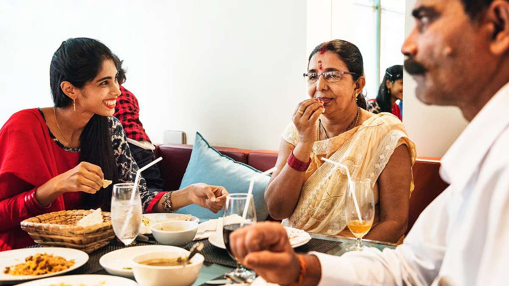

# Here’s why you shouldn’t take your diet lightly

*By Brahmarshi Acharya Upendra Ji · 2026-02-12T04:55:41+00:00 · Source: https://blogs.antaryogfoundation.in/heres-why-you-shouldnt-take-your-diet-lightly/*

These days, many diet and nutrition trends are gaining popularity. Some people want to gain or reduce weight, some control their intake of protein, carbohydrates, fat, etc. There are so many diet charts available on the internet for anyone to follow.

Despite that, you must be seeing a lot of health issues like blood pressure, thyroid, diabetes, cancer, depression, etc. reach almost every household. Today there are innumerable misconceptions about diet which we will cover in a series of articles.

The food and content you consume daily have the power to deeply impact your thoughts, words and actions. Your diet is much more than just a nutritional need.

Let us look at Chhandogya Upaniṣhad verses, which explain this. Verse 6.5.1 explains that the food you consume gets divided into three parts – most gross part of the food becomes human excreta, less gross part of the food becomes flesh and subtlest part of the food becomes your mind. Verse 6.5.4 and verse 6.6.6 again mention ‘annamayaṃhi somya manaḥ’ — the mind is formed by food. Verse 7.26.2, says ‘āhāra śhuddhau sattva śhuddhiḥ’ — by eating pure food, your mind becomes pure.

If our scriptures mention about the connection of food and mind, we need to understand this topic in detail.

Many of our great Sages, who were also great scientists discovered thousands of years ago through dhyān, which modern scientific research has proven today that the crystal structure of water physically transforms when it is exposed to negative and positive human emotions. When exposed to negative emotions, crystal structures got distorted; when exposed to positive emotions, symmetric and pleasing crystal structures were observed. Hence, our Sages advised praying, chanting mantra (मन्त्र) and thanking the Lord before eating so that it positively impacts the food. Both spirituality and science prove the effects of the subtle part of food on the mind.

Most of you may not be aware of the intention or mood of the person who prepared the food you ordered online or ate on the streetside. Food prepared with hatred, anger, boredom, abusive words, etc. will immediately start spoiling your emotions and eventually your physical well-being.

Most of you may be consuming your meals while watching TV shows, news, sports, etc. The excitement, disappointment, horror, tragedy, etc. of the game, crime, inappropriate content in shows, etc. becomes the food for your thoughts.

Let us look at the Bhāgavad Gītā verses related to diet. 17.8, 17.9 and 17.10, clearly classify what kind of food a person will prefer as per his guṇ. 14.5 states, nature (including all entities — living or nonliving) consists of three Guṇa — sattva (knowledge, happiness and detachment), rajas (actions and attachments) and tamas (ignorance, laziness, inertia).

17.8, describes that a person with sāttvik guṇ will prefer food which is easy to digest, juicy, non-spicy, non-oily, minimally processed and freshly cooked like green vegetables, fresh fruits, milk, ghee, pulses, dry fruits, etc. Such a diet results in calmness, happiness and gives long-lasting energy. If you use your vivek (discrimination power) and choose food wisely, thinking of the consequences before eating that food, you are a sātvik person.17.9, describes that a person with rājasik guṇ will prefer food which is too bitter, too salty, tangy, pungent, very hot or very cold, dry, and spicy like pickles, roadside food, sweets, baked foods or instant foods. If you excitedly eat the food first but regret it after suffering from its effects such as restlessness, hyperactivity, etc., you are a rājasik person.

17.10, describes that a person with tāmasik guṇ will prefer food that is decayed, stale, undercooked or overcooked, leftover, heavily processed, tinned, and impure such as meat, alcohol, etc. which makes you lazy, angry, anxious, etc. If you eat anything ignorantly even if it brings you a disease, you are a tāmasik person.

As per 4.29-30, annā (food) is also one of the means to attain ultimate liberation. Instead, it is commonly observed that today’s rājasik and tāmasik food habits of most people are becoming a blockage in their liberation. The purpose of food is to help you become nirogī (healthy), then a bhogī (righteously enjoying worldly pleasures with good health) and eventually a yogī (reach an advanced spiritual state).

It is time you stop taking your diet lightly and do not limit it as a means of nutrition, balancing calories or carbohydrate intake. Food has the power to affect your progress in life, hence you must learn the connection between food and your life from a spiritually realised Jeevīt Guru as only he can teach you rightly.
