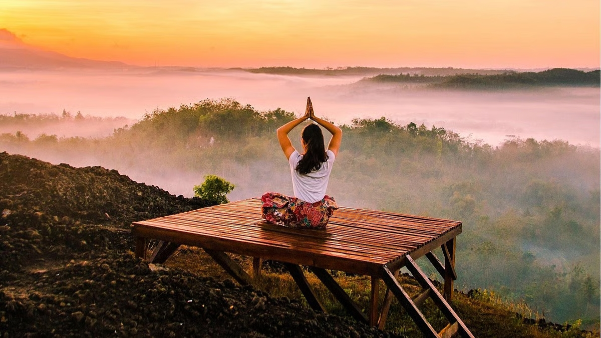

# International Day of Yoga: Your ‘yoga’ is incomplete without THIS

*By Brahmarshi Acharya Upendra Ji · 2026-06-20T03:30:00+00:00 · Source: https://blogs.antaryogfoundation.in/international-day-of-yoga-your-yoga-is-incomplete-without-this/*

What is the real definition of yoga? Is it the 30 minutes of morning exercise which you can proudly boast about on social media? Or an annual retreat? Or a tool to look young and be healthy? You may perfectly balance or twist your body, yet you are the same person without any transformation. Why? ‘Yoga’ comes from the word ‘yuja’, which means ‘to unite’ and the real meaning of yoga is to unite yourself with God. Is your ‘yoga’ practice bringing you closer to divinity? People practice yoga for years yet they are depressed, short-tempered, anxious, indulge in food and sex and are heavily attached to materialistic things. So what are we missing?

According to Patanjali Yoga Sutras, the most authentic scripture on yoga, there is an eight-fold path, eight limbs, leading to yoga — Yama, Niyama, Asanas (Yogasan), Pranayam, Pratyahara, Dharana, Dhyan and Samadhi. This simply means that there are two steps before Asanas; the prerequisites without which you can not even start doing your popular ‘yoga’.

Yama is the first limb meaning self-control, primarily focusing on five social ethics: Ahimsa (non-violence), Satya (truthfulness), Asteya (non-stealing), Brahmacharya (the practice of celibacy), and Aparigraha (non-greed or non-possession).

Niyama is the second limb meaning self-discipline focusing on the five personal ethics such as Saucha (cleanliness of the body and mind), Santosha (contentment), Tapa (self-discipline), Swadhyaya (study of the Self) and Ishwara Pranidhana (surrendering to the divine).

Today, it is common to lie, steal, kill animals for satisfying your tastebuds, expect gifts on every occasion, be violent and sexually hyper right from the school level. Gaining spiritual knowledge is the last priority for most of you and you don’t have time to study the ‘Self’ or our ancient scriptures which hold the highest secrets of life. Without practising tapa, you want quick results with crash courses. Be honest and tell me how many of you are following Yama and Niyama regularly in its true sense?

Today, its not very difficult to get a yoga teacher certificate. You just need to attend a few classes, pay fees and there aren’t any other qualifying conditions. A person may have multiple affairs, indulge in bodily pleasures, be egoistic and still may qualify for getting a yoga teacher certificate. Do you think the students will be able to understand the real ‘yoga’ by learning from such certified teachers? It is said that you must practice what you preach as finally it’s the aura of the teacher that gets transferred to the students and not their words.

Then how to learn the real yoga?

It requires rigorous tapa of at least 12 years in a Gurukul, by surrendering yourself to a Guru and being under his discipline to even understand the true meaning of yoga. Guru will teach you Ashtang Yog and decode the symbolic meaning behind the design of various asanas. Like the Shavasana that you do, is in fact an asana to contemplate the fact that you have to leave this body one day for sure. By doing Vrikshasana you should imbibe a tree’s giving nature and power to sacrifice. Surya Namaskar should help you have a radiant aura and inculcate the qualities of the Sun like self-discipline.

Then after a few years of practice and experiencing the results yourself, your Guru permits you to teach yoga to others. How many of you are willing to do this? Yoga is not something to be practised glamorously on a rubber mat in sports shoes and track pants. The idea of yoga is not just to focus, be happy, mindful and calm for the time that you’re on the mat, but to carry this state of being every living moment of your life.

Celebrating International Day of Yoga is a great initiative to make people aware of yoga and the benefits of practising it. But just celebrating it for a day and perfecting your yoga poses will not help you and our nation. It should be followed and practised in its true sense by understanding and applying its eight limbs, which is still missing in most of the cases.

Our country needs powerful, dedicated students with higher vision who learn Yog under the guidance of a spiritual master with rigorous penance. I have shown you the only path to ‘complete’ your ‘yoga’. Are you prepared to walk on it?

Merely having a real guru does not ensure you will follow the right path. Just like the map’s navigator, no matter how many times you take a wrong turn, the real Guru will keep showing the path to reroute you from the new spot to the original destination of Nar se Narayan. It’s your decision if you want to walk on that path or get hit by roadblocks until you finally make the right choice.

With immense faith and devotion in your Guru, you earn the ability to recognise your inner voice which is nothing but Guru tatva guiding you on the right path and your life becomes blissful.

Now, will you still prefer going to anyone to get easy remedies and get uncertain relief from your problems or set out on the quest to find a real Guru to get permanent freedom from your problems? I am sure now you must have got the correct understanding to check if you have met a real Guru!
