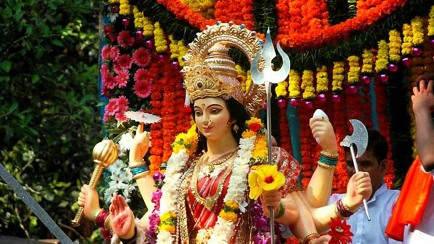

# Navratri: How To Celebrate This Festival In Its True Sense

*By Brahmarshi Acharya Upendra Ji · 2026-07-10T03:30:00+00:00 · Source: https://blogs.antaryogfoundation.in/navratri-how-to-celebrate-this-festival-in-its-true-sense/*

You must be prepared and excited to celebrate Navratri like every year. But, have you ever wondered why it is celebrated only for nine nights? Is the Navratri celebration only limited to bringing Durga idols, doing Durga pooja, fasting, playing garba, offering prasad, immersion, etc? In reality, it is about your own inner journey and progress to achieve extraordinary success. Let me explain the deep symbolism and the ideal way to celebrate Navratri, in this article.

Durga Devi is also known as *shakti, mul prakruti* (nature) or *maya*. *Maya* is nothing but an illusion about the world you see. This *maya* is very difficult to conquer. The origin of the word Durga comes from ‘durgam’ – meaning that which is very difficult to conquer. Bhagavad Gita 7.14 – also states that *maya is* very difficult to conquer. It is mentioned in Bhagavad Gita 14.5, that nature (including all entities – living or nonliving) consists of three *guṇas* –  *sattva* (knowledge, happiness and detachment)*, rajas* (actions and attachments) and *tamas* (ignorance, laziness, inertia). Hence, *Durga Devi* is also called as *‘trigunatmika’* represented by Maha Kali (tamas), Maha Lakshmi (rajas) and Maha Saraswati (sattva).

Navratri or the nine nights symbolise the nine levels of ignorance that can hinder your progress and liberation. As per Patanjali Yog Darshan chapter one verse 30, the nine levels are vyadhi (ailments of the body), styan (lack of interest in spiritual path), sanshay (doubting one’s own capacity to pursue spiritual practices and on the fruits of spiritual practices), pramad (unwilling to pursue spiritual path due to worldly attractions), alasya (laziness in following spiritual practices), avirati (obstacles in spiritual path due to worldly responsibilities and attachments), bhranti darshan (incorrect ideas about spiritual practices), alabdha bhumikatva (loss of interest in spirituality as one finds it difficult to follow the path), anvastitatva (starts the spiritual path correctly but can not continue for a long time).

To overcome these nine levels of ignorance you need to pass through nine stages of spirituality. They are represented by the *Navdurga* which starts from *Shailputri.* Shailputri means the daughter of the mountain or *shail* i.e. *stone* and represents a common man. After this stage comes the Brahmacharini stage. It represents following *brahmacharya* strictly and doing intense sadhana to evolve further into *Chandraghanta, Kushmanda, Skandamata, Katyayani, Kalaratri, Mahagauri* till you reach the stage of *Siddhidatri. Siddhidatri* is the Goddess who grants *siddhis*/powers. At this stage, you yourself become that realised *Guru* who has several *siddhis* and can selflessly grant them to others. These are the nine spiritual steps and not merely names of Devi that you worship. It also represents your inner journey from *Muladhar (root) chakra to Sahastrar (crown) chakra.* This is a process which you need to learn in-depth only from a realised *jeevit Guru* who has reached that *Siddhidatri* state.

These nine days also symbolise how you need to live your life. They are divided into three parts – first part for Maha Kali, second for Maha Lakshmi and the last for Maha Saraswati. It symbolises that first, you need to destroy the negative qualities like ego, lust, jealousy, anger, fear, etc. within you. After that, you need to awaken the divine qualities represented by Maha Lakshmi like love, faith, devotion, forgiveness, etc. Only when you reach this state, you can grasp the spiritual knowledge represented by Goddess Saraswati given by a jeevit Guru with a pure mind full of faith and devotion.

Hence, Durga Saptashati also has its chapters in the same sequence. The first part or *pratham charitra* is about Goddess Maha Kali. The second part or *madhyam charitra* is dedicated to Goddess Maha Lakshmi. The third part or *uttar charitra* is about Goddess Maha Saraswati.

After reaching the final stage, you start seeing the same Devi in everything around you (‘*ya devi sarvabhuteshu…*’) as stated in *tantrokta Devisuktam* in the true sense. As a result, as mentioned in chapter 13 of Durga Saptashati, you get power, wealth and wisdom all at once. You also get ultimate liberation (moksha). This is the true celebration of Navratri.

In Mahabharat, before the Kurukshetra war Lord Krishna advised Arjun to perform Goddess Durga’s sadhana first. Krishna was capable of killing the enemy and winning the war single-handedly, but he wanted Arjun to win his inner battle, conquer his inner *maya* and then the outside battle. This also means that Arjun learnt the decoded knowledge of Goddess Durga from Lord Krishna and applied it in life to awaken divine power within him.

Even a great warrior like Arjun would not have won the war without Goddess Durga’s power. Similarly, you must also awaken the same power within you to overcome all big or small hurdles in your life. Only a competent spiritual Guru can decode the hidden secrets from our scriptures, initiate you with a powerful Durga Saptashati Tantrokt Beej mantra *sadhana* and completely transform you helping you gain power, wealth and wisdom all three at once.
