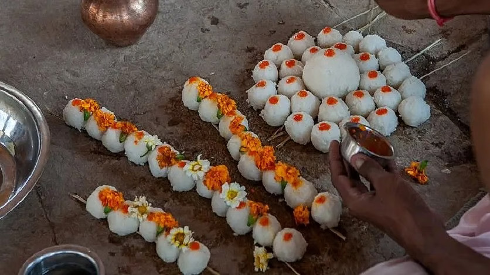

# Pitru Paksha: Real Secret To Liberate Ancestors & Solve Problems

*By Brahmarshi Acharya Upendra Ji · 2026-07-08T03:30:00+00:00 · Source: https://blogs.antaryogfoundation.in/pitru-paksha-real-secret-to-liberate-ancestors-solve-problems/*

In India, the 15 days of Pitru Paksha has great importance. As per our Vedic scriptures like Garud Puran, Bramha Puran, etc. rituals of pind daan, shraddha, tarpan, donation, etc. should be performed to help the souls of your ancestors to attain peace, liberate or move on to their next births. River ghats/holy places are flooded with thousands of people during these days to perform these rituals. Special pooja and shraddha vidhi packages are offered during this period.

Our scriptures like Garud Puran, Vishnu Puran, etc. say that during Pitru Paksha, pitar desperately wait for someone wise in their family to liberate them. But it is not so easy to liberate your ancestors by merely performing such rituals mechanically. The knowledge of these rituals is missing today. Most of the rituals are still mistaken as superstitions. Some of our profound scriptures are highly misunderstood. Crows are forcefully made to touch the offerings for few rupees, mocking the entire idea of paying respect to the departed. Let me clear some of these major misconceptions and share what is supposed to be done to truly liberate your pitar.

‘Pitar’ is a painful state. At the time of death, when a soul departs unsatisfied with a lot of attachment, unfulfilled desires, ill will, worries, etc. it stays attached to its unfulfilled desires, loved ones, property, wealth, etc. The soul also realises and regrets the grave mistakes/ sins it has made in its lifetime. But the soul cannot fix any of it now as it does not have a body. These regrets, attachments, desires, etc. deeply trouble the departed soul.

Gautam Buddha renounced his kingdom when he realised that he, too, could become sick, would grow old, die, and lose everything he loved. He contemplated this and was able to live a detached life thereafter. Lord Krishna also clearly states in Bhagavad Gita 13.8 that you must contemplate your birth, sickness, old age and death again and again. This knowledge is extremely important. Imagine you are driving a car without knowing the origin and destination of your journey. You do not have a roadmap either and are blindfolded. You will travel aimlessly without knowing your destination and can meet with an accident. Similarly, at the time of death, you need to know where you as a soul have to go.

It is the lack of this spiritual knowledge that makes it even more difficult for it to liberate and it continues to exist in this painful state. This knowledge can be given only by a jeevan mukta Guru (God realised) who has travelled that road and reached the destination. Hence, it is your first and foremost duty to liberate your ancestors from this painful state.

Not doing so further enrage your pitar. Our scriptures state, that before liberating them as prescribed in the scriptures, your pitar do not allow you to carry out any other duties. You will start facing financial losses, court cases will prolong, marriage will not get fixed or problems will start arising in married life, you will have issues in conceiving a child or have frequent miscarriages, and hindrances can come in your career. Despite having great potential you will have to struggle more than others. The list of problems does not end here.

The dosh amplifies and is carried forward to the next generations till it is fixed. You get the pitru dosh of ancestors, both paternal and maternal from your last seven generations. These seven generations of your past seven births are counted. Multiplying these numbers shows that each person affected by this dosh carries 49 times the negative karma of their pitar. If the negativity increases to a great extent, it mostly results in the birth of handicapped, specially-abled offspring who will not be able to continue the generation ahead resulting in the end of your entire lineage.

The rice balls or pind created for pind daan have a deep symbolic meaning. You are supposed to send them prayers for them to depart towards their destination and assure them you will live peacefully with everyone without any conflicts and apply it in life. Similarly, your ancestors do not come in the form of crows. Crows only have the power to sense spirits/souls. They eat the offering only if they do not sense any spirits around it. It is only an indication that the soul has moved on in its journey. Hence, in order to liberate your ancestors and remove your pitru dosh, performing mechanical rituals once a year is not enough.

You are ideally supposed to go to a realised spiritual master — a jeevit Guru and take the highest spiritual knowledge from our scriptures like Kathopnishad, Garud Puran, Vishnu Puran, Bhagavad Gita, etc.. He conducts powerful sadhanas for you and your pitar. Just like only a wealthy person can make you wealthy, only such a jeevan mukta Guru holds the capacity to truly liberate your ancestors. Only a competent Guru can tell you how this most feared dosh is a boon to you. Vishnu Puran mentions that if you go to such a Guru with the intention of liberating your pitar follow everything he teaches, they bless you tremendously which starts clearing all the blockages in your life.

Antar Yog Foundation conducts a unique Pitru Rin Mukti shibir every year during Pitru Paksha to liberate your ancestors, which gives you instant results.
