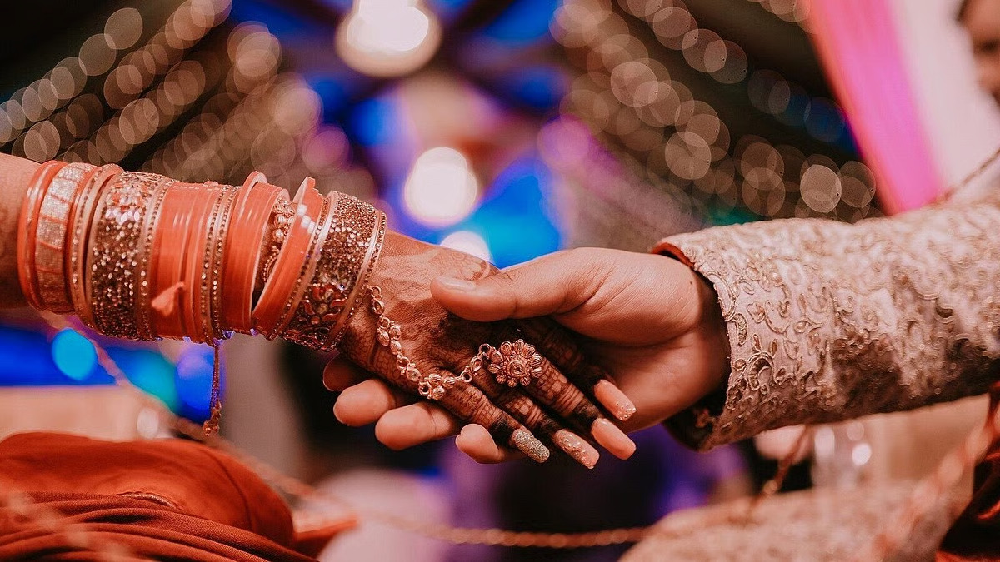

# Significance of a perfect life partner in every woman’s life

*By Brahmarshi Acharya Upendra Ji · 2026-02-12T04:55:42+00:00 · Source: https://blogs.antaryogfoundation.in/significance-of-a-perfect-life-partner-in-every-womans-life/*

For every woman, her marriage is a turning point in life. In our culture, every marriage is considered a divine union between Shiva (husband) and Parvati (wife). But today, are women able to choose life partners like Shiva? Earlier, marriages used to be fixed on the basis of positive attributes such as spirituality, generosity, service attitude (seva bhav), humility, working for a higher cause, etc. But today, compatibility is based on negative attributes and habits such as partying, shopping luxuriously, overspending, lavish lifestyle, drinking, smoking, consuming non-veg, etc. Only worldly accomplishments and outer beauty are sought-after and highly valued in marriages. But a marriage based on such a weak foundation is most likely to collapse at the first setback. From such an alliance what kind of a generation do you think will be born?

Marriage is an auspicious event i.e a *Mangal Karya*. And, in our Bhartiya culture, women adorn an ornament called *Mangalsutra* in their necks after marriage*.* But, have you ever wondered what it signifies? Why is it specifically called *Mangalsutra* and not *Shanisutra or Gurusutra*? Mangal refers to the planet Mars, indicating qualities like courage, bravery, good leadership, confidence, and physical strength that you must look for in your life partner before marriage. An ideal husband should possess these divine qualities. It is also to remind women to maintain joy and happiness at home.

In an ideal marriage, the partners complete each other. Their shortcomings and strengths should complement each other. It is advised as per scriptures to have a life partner who is in a different profession than yourself, but both partners should be like-minded and learn to adjust to situations. Extreme opposite qualities or too many alike qualities lead to constant conflicts.

Women are inherently blessed to choose the right life partner. Let me give you an everyday example which every woman can relate to. When you have to travel in a crowded bus just for 20 minutes and you see that the only vacant seats are next to men, you are able to choose a seat next to a decent male in one glance. When you can perfectly select the right companion for a short journey, then how do you fail to choose your life partner wisely? It is because while choosing a life partner you make decisions out of emotions, instead of using your intellect! Men know this weakness of women and will keep following you, talk sweetly and send you gifts till you say ‘Yes’. But, always remember, no demon comes in his real form. Even Ravan came in the disguise of a *brahmin* to fool Devi Sita. No matter how good you and your intentions are, you can be deceived. If you fall prey and choose a Ravan it can ruin your life forever. Hence, as a woman, you should be wise and not an emotional fool.

In the story of *Durga SaptaShati,* the demon king Shumbh sent his sweet-talking messenger Sugreev to lure Durga Devi to marry Shumbh. But she did not fall prey to it and rejected the proposal firmly and fearlessly. In any situation, women have the choice to either accept or reject any proposal from men. In cases of broken marriages, extramarital affairs, premarital pregnancy, etc. it is only the woman who has to suffer the undesirable consequences and gets defamed. Even if the woman belongs to a royal family, she has to face the same consequences. Hence, you should be wise and careful about your choices.

As mentioned in Bhagwad Gita 1.41 – 1.43, for families to be religious, and societies to be moral, it is necessary that women be virtuous and choose their life partners wisely. If the women of the family turn towards immorality and commit adultery, they bear a science-minded generation who does not believe in our scriptures. They become selfish and indulge in worldly pleasure. This results in the downfall of family traditions with the welfare of the entire society at stake.

Physical attraction in a marriage is *kaam agni* (fire). You need to be cautious with fire. If you play too much with fire, it can burn you completely. If you have married purely on the basis of physical attraction, it can make you suffer, ruin your life completely and you are doomed for several births.

In order to attract the perfect life partner, you must realise the divinity in you and awaken the *Devi* within. Only then you can choose a righteous life partner who leads a principled, ethical life just like Shiva. Only such a marriage can prosper and such partners can give birth to children who are capable of becoming achievers, leaders and bring great pride to the family.

It is absolutely necessary that today’s women learn *Vedant* from a spiritually realised Jeevit Guru. Only a Guru can truly empower you, and awaken the divine power in you to make you fierce and radiant (*tejasvi*) like Devi. Women of our country need to keep our dharma*,* scriptures, culture, values, etc. alive and inculcate the same in the future generation. When a woman chooses and marries the right life partner, she truly lives happily, gets all her freedom and respect, can raise a righteous generation, progress spiritually and gets liberated.
