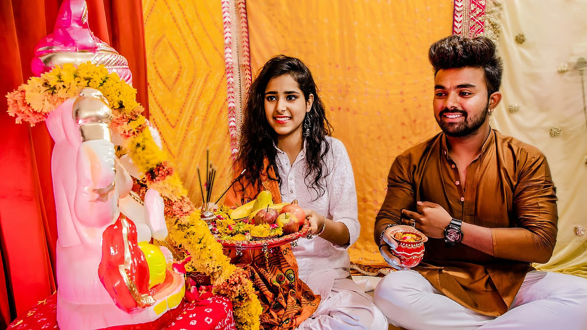

# The art of leading a virtuous life that every woman must know

*By Brahmarshi Acharya Upendra Ji · 2026-02-12T04:55:42+00:00 · Source: https://blogs.antaryogfoundation.in/the-art-of-leading-a-virtuous-life-that-every-woman-must-know/*

Today, women are not aware of their righteous duties as per our scriptures. But, they are not at fault completely. In our country, which was ruled by foreign invaders for thousands of years, women got their freedom only a hundred years ago. Our great leaders like Lokmanya Tilak, Swami Vivekanand, etc. wanted women to learn Vedant and only then step out of their houses. But, under the influence of the Britishers, our women were freed suddenly before they learnt Vedant, which has resulted in the imbalance in the society that you see today.

Let me start with why our scriptures have prescribed that we follow righteous duties in every role that we have. As Acharya Chanakya mentions in Chanakya Niti – the base of ‘sukha’ (true happiness) is ‘dharma or kartvya karma’ (righteous duties) i.e Sukhasya Mulam Dharma. Hence, to gain true happiness in life, performing righteous duties is not optional. Let us understand the righteous duties of a woman as a wife.

Pativrata means a virtuous wife who has made a vow (vrata) of following her righteous duties (dharma) in the presence of God, her husband, brahmins, both families and the public during the marriage. Our scriptures say that an ideal wife is faithfully devoted to her husband and serves him as the Lord. She puts her whole heart into keeping him happy. She fulfils his righteous wishes and is always loyal, kind, supportive, sincere and respectful in her behaviour. For an ideal wife, selfless service to her husband is higher than any donation, idol worship, fasting or pilgrimage. Such a devoted wife is equal to a yogi. It is said that even Lord Brahma, Vishnu and Mahesh offer their respect to such a virtuous woman. Devi Sita is a perfect example of pativrata stree. She instantly agreed to accompany her husband Shree Ram in 14 years of exile, happily giving up all the comforts of the Kingdom. When Ravan kidnapped Devi Sita, she remained faithful to her husband. She worshipped Shree Ram as Lord and was devoted to him till the end of her life.

Today women have a wrong understanding of pativrata dharma. Women feel that being pativrata, means sacrificing all their personal dreams, goals, and just keep serving their husbands by staying at home and tolerating everything quietly. But this isn’t true. A woman can be an employee or a CEO, yet can balance her duties as a virtuous wife, daughter-in-law and mother. A woman can be modern with a good lifestyle, yet not lose touch with our culture and traditions. Rani Lakshmi Bai, Ahilyabai Holkar and many more are the greatest examples of achievers who were also ideal wives.

Today, mistreating in-laws, degrading husbands, keeping bad company, not following spiritual discipline, using abusive words, consuming alcohol, etc. has become common among women. Women worship Shiva in temples, and typically keep a fast on Mondays, but poorly treat their husbands who have come in the form of Shiva. These are not the signs of an ideal woman.

When a woman moves away from her divinity, her life becomes full of problems and she may suffer for many births. When women suffer, the entire society suffers. The significance of pativrata women is exceptional. For yug parivartan (transformation in society), the world must have more of these seven kinds of persons — ones who follow scriptures, sacrifice for others, do good deeds, women who follow pativrata dharma, people who are truthful, non-greedy and generous.

This doesn’t mean that only women have to learn Vedant and men are excused. Men also have to learn Vedant. But it is a woman who gives birth to a man, and when she learns Vedant , she is fully aware of her duties, she correctly raises her child as a virtuous man.

By being a true pativrata as a woman you will attain the greatest joys of life. You will attain keerti (perpetual fame), tej (radiance), and easily overcome all your problems. Only a Jeevit Guru can help you understand your duties correctly and open the doors for your ultimate liberation.
