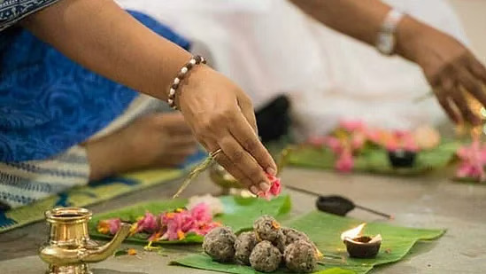

# Thousands Of Seekers Attend Antar Yog Pitru Rin Mukti Shibir Every Year During Pitru Paksha And Get Instant Results Thereafter

*By Brahmarshi Acharya Upendra Ji · 2026-07-06T03:30:00+00:00 · Source: https://blogs.antaryogfoundation.in/thousands-of-seekers-attend-antar-yog-pitru-rin-mukti-shibir-every-year-during-pitru-paksha-and-get-instant-results-thereafter/*

A rare combination of ancient secrets, powerful rare sadhana and a competent Jeevit Guru found nowhere else guarantees the immediate liberation of your ancestors, enlightens you with immense knowledge and helps you attain success in career, married life, conceiving a child, pending court cases, health, etc.

Most of you may be facing or see people around you dealing with issues like financial losses, prolonged court cases, hindrances in career, accidents, conflicts within the family, failure in conceiving a child, miscarriages, addiction, etc. One of the major reasons for this is pitru dosh or pitru rin. It is observed by many astrologers and spiritual gurus that 90% of people have this dosh/ rin in their birth chart.

Pitru dosh is identified from your birth chart (kundali). This dosh comes when the soul of your parents, ancestors, etc. is departed unsatisfied with a lot of unfulfilled desires, attachment, ill will, worries, etc. The soul also realises and regrets the grave mistakes/sins it has made in its lifetime, but cannot fix them as it does not have a body. These regrets, attachments, desires, etc. keep the soul troubled. It neither liberates nor moves on to its next birth and continues to exist in this painful state called the ‘pitar’ state. If you are also living an unhappy life, have unfulfilled desires, or addictions, commit suicide, or die an unnatural/untimely death like your any of ancestors, you can also become a pitar and stay stuck in this state for centuries. Merely performing pind daan/other mechanical rituals for one day, is not sufficient to liberate any ancestor from this painful state.

Acharya Upendra Ji, a spiritual master, the founder and leader of Antar Yog Foundation says, “Pitru dosh gets passed onto the next generations until it is fixed. There are cases where multiple generations have been ruined because of this dosh. If you donate on behalf of your ancestors as taught in Antar Yog as per Bhagavad Gita, take the highest spiritual knowledge from a realised Jeevit Guru, etc. they will be satisfied and bless you. Hence, liberating your ancestors is your first and foremost duty. Today this knowledge is missing. Our country cannot progress easily to the position of a spiritual and economic superpower if the majority of the population is troubled with this dosh. As per our scriptures like Garud Puran, Vishnu Puran, Bhagavad Gita, etc. it is impossible to fix this dosh without contemplating the root cause which only a jeevan mukta (God realised) Guru can teach.”

With the intention of the overall progress of individuals and the entire nation, Acharya Upendra Ji introduced a 15-day shibir, ‘Pitru Rin Mukti’. He has been giving this knowledge for the last 18 years, which is not being taught anywhere in the world today. Acharya Ji proves how this dosh is a labh (boon) to you if you apply those teachings.

“Along with liberating your ancestors, this discourse will give you the purpose of your birth and your role in this life, which only a Jeevit Guru can help you understand. Pitru Rin Mukti is equally important if you are seeking higher truths in life. It will give you both worldly progress and spiritual liberation,” says Acharya Ji.

Acharya Ji decodes scriptures like Garud Puran, Kathopanishad, Bhagavad Gita, karma rahasya (secrets of karma) and many other scriptures in this course. He conducts powerful, secret and rare sadhanas for you and your ancestors which give instant results. Acharya Ji also conducts a powerful meditation, to experience ‘life after death’, to help you understand the importance of living a spiritually enriched life. Shraddha vidhi and Pitru Rin Mukti yadnya is also performed at the end of the course.

Thousands of seekers who attend this shibir experience immense transformation in their lives. Almost every seeker testifies after shibir that they have gained knowledge, all their desires have been fulfilled, and are devoted to a higher cause.
