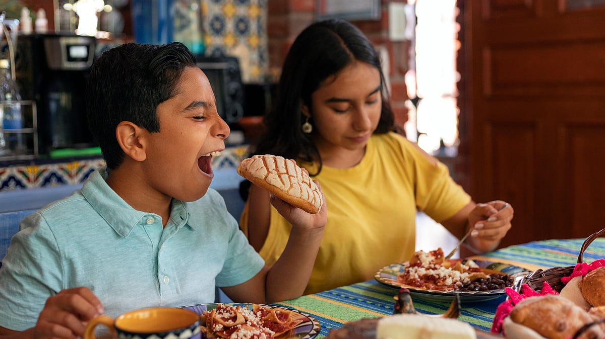

# Did you know that there is a connection between food and your karma?

## There is a reason why our scriptures advise consuming food that is local to the place where you were born

*By Acharya Upendra Ji · 2023-08-06T07:00:00+05:30 · Source: https://www.freepressjournal.in/weekend/did-you-know-that-there-is-a-connection-between-food-and-your-karma*

Today, in Bharat you must be seeing a lot of western influenced foods such as oats, quinoa, gluten-free flour, etc. being heavily promoted and gaining popularity. Most of you are inclining towards a western influenced diet like salads, smoothies, etc. with exotic fruits/vegetables like blueberries, avocados, broccoli, lettuce, etc. than your homemade poha, paratha, etc. But did you know your diet has a subtle connection to the country where you live and your karma? Let me reveal it in this article.

There is a reason why our scriptures advise consuming food that is local to the place where you were born. You are born or later have to settle in a particular country/state/city because you have a runanubandh (ऋणानुबंध — karmic bond) from past birth, with that specific region, also known as sthan run (स्थान ऋण). You also lovingly call India ‘Bharat Mata’ as the country provides everything for you like a mother. You live here, earn money, utilise infrastructure, etc. daily to sustain. This adds to your karmic debt towards your country. Before serving other countries, you need to ensure you serve your own motherland first. Just like you serve your own mother first because she gives you birth, feeds you, and makes innumerous sacrifices for you, you become indebted to her.

Similarly, your karmic bond is not just with your country, but also with the citizens of the country. The farmers are our ‘anna data’ (food providers). You share a karmic bond and are karmically indebted to farmers of the country because whatever you consumed from your birth till your death, is cultivated by them. It becomes your duty to pay back this karmic debt or it starts amounting as a dosh.

> **Read Also:** [Her right education is our bright future](https://www.freepressjournal.in/spirituality/her-right-education-is-our-bright-future)

When exotic fruits, vegetables, cereals, pulses, food products, etc. are imported from foreign countries, their economies strengthen but it impacts our farmers. Exotic fruits and vegetables are easily purchased at higher prices. But the local farmer is forced to sell his produce at a negligible price, give it for free or dispose it. This is causing unhappiness and is also one of the major reasons many farmers in our country are committing suicide today. This amounts to a dosh on your account. Such imports also burden our economy with huge financial debts.

Even if you were to cultivate foreign crops in your country, the crops will still contain the original qualities and genes of their native countries and are suitable for the people there. For example, avocado is native to South-Central Mexico and is a staple in Mexican cuisine. If you cultivate avocados in Bharat, you will be able to digest them initially but their consumption can cause health issues eventually. It will also be unfair to farmers who produce avocados in South-Central Mexico.

This does not mean you are not allowed to eat food produced or influenced by foreign countries. It is allowed only occasionally. If you make it your primary diet and consume it daily, you will face health issues someday. For example, someone from the United Kingdom may enjoy a spicy Indian meal once, but he will not be able to make it his main food daily. Because in the United Kingdom, food is cooked plain without much spices. Even if that person settles in Bharat, he will not be able to switch to an Indian diet as he will still have the same genes and qualities native to the United Kingdom.

> **Read Also:** [The untold purpose of your diet that you should know](https://www.freepressjournal.in/weekend/the-untold-purpose-of-your-diet-that-you-should-know)

Let me explain with another example. Fish and meat are the staple diet of people in some states of Bharat. Vegetables, cereals and other crops are cultivated in our country. Yet, why do they feel like eating fish/meat? Why are there sources or shops of fish/meat in that region? Because you consume meat, the butcher/fishermen have to kill the fish/animals for you and commit a sin (paap). Even if you do not kill the fish/animal directly, you are still committing a sin by consuming its meat. Every fish/animal and person in this chain has a karmic connection with that land. But, that does not mean the people there are forced to eat only fish/meat. They can switch to a vegetable-based diet. If it is not easily available, they can choose to leave that region. If neither option is working for them, it can be an outcome of some pending karma, which is why they have to consume it. Till the karma ends, they will not get over the desire of consuming the fish, however, it will continue amounting to a big sin of killing the fish/animal on them. Some communities also take pride in consuming a non-vegetarian diet and have a misconception that they liberate the animal and earn merits (punya) by consuming its meat. Instead, due to the big sin of consuming meat, they may lose their own chance of liberation.

Hence, diet is to be chosen responsibly. No matter how much one may argue from lower consciousness, the sins will not be reduced. Some rules are made by nature.  Only a spiritually realised Jeevit Guru teaches these concepts correctly from a higher level of consciousness. A good shishya immediately understands this whereas others find reasons how to satisfy their taste buds.

In the next article, we shall dive deeper into this subject and understand the repercussions of a meat-based diet. Stay tuned!

> **Read Also:** [Here's why you shouldn't take your diet lightly](https://www.freepressjournal.in/spirituality/heres-why-you-shouldnt-take-your-diet-lightly)
