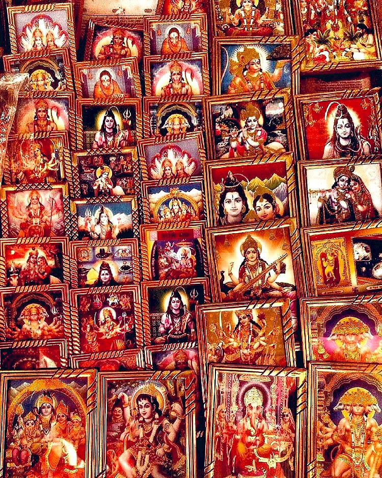

# Do Hindus really have 33 koti devatas? Here's the truth behind the belief

## Many link its origin to the fact that Hindus worship every element as God and hence they have 33 crore (koti) devtas

*By Acharya Upendra Ji · 2022-09-25T07:00:00+05:30 · Source: https://www.freepressjournal.in/spirituality/do-hindus-really-have-33-koti-devatas-heres-the-truth-behind-the-belief*

Our journey in this series has come to an important turn. In the previous article, we understood the thought process of our saints behind designing the system of many forms of one God, each representing a particular quality or energy of the ultimate formless God.

In this article, I shall be answering the commonly asked question: ‘Do Hindus really have 33 koti (crore) devatas (deities)?’

Many link its origin to the fact that Hindus worship every element as God and hence they have 33 crore (koti) devtas. Some find it a subject of mockery and many blindly follow it without knowing its true significance. Let me reveal the truth today. The word ‘koti’ in Sanskrit means crores and also it means ‘type’. In this term ‘33 koti’ means 33 types and not 33 crores. There are 33 types of devatas having their unique qualities and powers. Taittiriya Upanishad, ch 8.1, mentions the fact that there are 33 types of devatas.

> **Read Also:** [Why multiple forms of God were designed and their deep significance as per our scriptures](https://www.freepressjournal.in/spirituality/why-multiple-forms-of-god-were-designed-and-their-deep-significance-as-per-our-scriptures)

In the Brihadaranyaka Upanishad, ch 3.9.1, it is mentioned that numbers like 33 crores or 3003 or 303 are incorrect. There are 33 types of devatas which are principal manifestations of God. Yadnyavalkya Rishi authoritatively states that ‘God is one, but he has many names and forms’. In Durga Saptashati, ch 10.4, Goddess Durga too mentions that ‘I am all alone in this world, all the other forms are my forms only’, indicating that God is one.

Likewise, many other Scriptures like Atharva Ved, Rig Ved, etc. clearly mention only about 33 types of devatas. These 33 types of devatas are: eight Vasus, 11 Rudras, 12 Adityas, Indra and Prajapati. Let me tell you their significance.

The eight Vasus represent different aspects of nature, which are earth, water, fire, air, ether, moon, sun and star. Vasus mean where living beings dwell or support life. For example, earth is a dwelling of a vibrant ecosystem and the Sun supports life by providing the life force energy. Vasus are maintainers of the life cycle in the universe and hence since ancient times we worship elements of nature as God.

> **Read Also:** [Why do people worship symbols or photos? Tracing the origin of idol worship](https://www.freepressjournal.in/spirituality/why-do-people-worship-symbols-or-photos-tracing-the-origin-of-idol-worship)

The eleven Rudras are inside you, they are five Karmendriyas and five Dnyanendriyas (sensory and motor organs) and one mind. Some also refer to the 11 Rudras as the 10 Praan which are the life force energy within us and the 11th as the mind. When any of our organs stop working or when at the time of death our body becomes lifeless, this becomes a cause of tremendous suffering for our loved ones and us. We feel pain even when one of our nails gets chipped. Any harm to our body organs becomes a cause of our sorrow hence the name Rudra i.e. anything whose loss can cause you to cry. Just like the heart, eyes, ears or any other organ right upto cells, serve us and their loss causes us a lot of pain. Hence they are called Rudras.

The twelve Adityas are 12 months of the year. That which takes everyone along is Aditya. The life of a human passes as the months pass. The time takes everyone along.  Similarly, Adityas also indicate people with a legendary mentality who have conquered time (become kalateet), live selflessly and dedicate all their time for the welfare of society. Such leaders ensure that every person associated with them also grows and becomes successful. Hence, they are equal to devatas in this world.

> **Read Also:** [Why do good people suffer? Here's why](https://www.freepressjournal.in/spirituality/why-do-good-people-suffer-heres-why)

Indra is a deity of energy. Rain, lightning and thunder are powerful forces on this earth, controlled by Indra. But, Indra is also the force and power that is hidden in everyone. People who use this energy to the fullest become legendary and live extraordinary lives. They use this thunderous force for achieving larger-than-life goals with lightning speed. They also have the power to stand against unrighteous acts. Hence they are devatas. Bhagavad Gita, ch 10.41, clearly states that those people who are glorious, beautiful, powerful and have great recognition in society, have manifested more of God’s divinity.  Prajapati is identified with yadnya, which doesn’t mean mere offering in the sacred fire, it means making sacrifices. Every living being knowingly or unknowingly makes sacrifices. Plants release oxygen and absorb carbon dioxide. Snakes prey on rats and the population of rats stays under control. Cows give us milk which we drink from our childhood. Thus, for the world to function correctly, every living being is contributing. Among all species, humans are capable of making most sacrifices. Bhagavad Gita ch 3.14-15 states that Yadnya-bhav or the will to selflessly make sacrifices for others balances the entire nature. God is present in such acts of sacrifice.

> **Read Also:** [Guru Gyan: Who is a real Guru?](https://www.freepressjournal.in/spirituality/guru-gyan-who-is-a-real-guru)

Thus with the concept of 33 koti devatas, our great saints meant that whatever we see with the above mentioned qualities in the outer and inner world are all devatas.  They are the powers of the supreme Lord. Hope you have now understood the deep significance of the 33 koti devatas that are manifestations of the one infinite, formless God.

Now that you have learnt this truth, I shall be shedding light on whether multiple forms of God are prevalent in all religions or just Sanatan Dharma. Stay tuned.

**(The writer is a spiritual leader and the founder of Antar Yog Foundation. To know more about the foundation, visit https://learn.antaryogfoundation.in)**

> **Read Also:** [FPJ Anniversary 2022: Bharat’s future and your big role in it](https://www.freepressjournal.in/spirituality/fpj-anniversary-2022-bharats-future-and-your-big-role-in-it)
