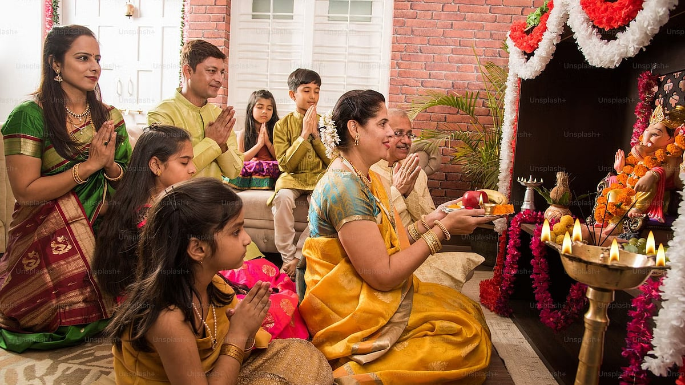

# Ganesh Chaturthi 2023: Celebrate The Festival In The Right Way

## Ganesh Chaturthi is one of the most celebrated festivals among people across the country

*By Acharya Upendra Ji · 2023-09-17T07:00:00+05:30 · Source: https://www.freepressjournal.in/weekend/ganesh-chaturthi-2023-celebrate-the-festival-in-the-right-way*

Ganesh Chaturthi is one of the most celebrated festivals among people across the country.  Crores of rupees are spent by devotees for organising the grandest pandals, making the tallest idols, creating unique themes and decorations for winning competitions, managing the event, preparing delicacies, distributing sweets, buying new clothes, etc. Lord Ganesh’s favourite modak is offered, recitation of Atharvasheersha and many other rituals are performed in the ten days of celebration. Every home, lane and street gets flooded with millions of devotees visiting various pandals, worshipping and offering their prayers to Lord Ganesh with devotion.

Nowhere in the world, you will find any deity worshipped as much as Lord Ganesh is worshipped in India. Lord Ganesh, also known as Vighnaharta, is the remover of obstacles. Then despite so much worship, fasting, pooja, etc. why is our country still not free from problems like poverty, unemployment, brain drain, corruption, etc.? Is your life happy and problem-free too? This means your understanding of idol worship and other rituals, mythological stories, ancient scriptures, gods and goddesses, etc. is somewhat incomplete and incorrect.

Before celebrating Ganesh Chaturthi have you ever wondered why Lord Ganesh has an elephant head? Why modak or only durva grass is offered to Lord Ganesh? How does such a huge Lord Ganesh ride on a tiny mouse? As a devotee, these questions should arise in your mind and you must seek answers before doing anything, otherwise, you are simply following the ignorant crowd blindly, who have devotion but not knowledge. Ishavasya Upanishad, verses 9 to 11, clearly mentions that — those who blindly perform actions (karma) without taking knowledge experience pain and suffering, those who are only after the knowledge without practically performing any actions end up experiencing even more pain and suffering.

> **Read Also:** [Do saints commit sin if they consume meat?](https://www.freepressjournal.in/weekend/do-saints-commit-sin-if-they-consume-meat)

The word pooja consists of two syllables ‘Pa’ and ‘Ja’. ‘Pa’ refers to ‘paap nashanam’ i.e. to destroy your sins, ‘Ja’ refers to ‘janma vichhedanam’ i.e. to break the vicious cycle of birth and death. The pooja, which you must have been performing religiously daily for years, must not be serving this purpose.

When you look for a life partner, will you marry just by seeing his/her photo? Will you not try to know the person first, check their family background, etc. and then make a decision about marrying? Likewise, if you are worshipping any idol, photo or yantra blindly without understanding or knowing your God is like marrying the photo/idol of a stranger. Even if you worship with devotion, it is not enough. Just like you need the biodata and other details of the person, you also must know all the details of the God you worship. The Bhagavad Gita, 7.17, clearly mentions that amongst all kinds of devotees, the highest is the one with wisdom (gyani) and is the one who is most loved by God. The Bhagavad Gita, 9.26, says, ‘When a devotee makes an offering of a leaf, a flower, a fruit, or even water to God with utmost sincere love and devotion, God himself comes to partake the offerings.’ Becoming a devotee is the first condition for idol worship.

Our great sages designed rituals for common people to reach the ultimate infinite formless God stepwise. Idol worship is the first step. But, without understanding the symbolic meaning of your God and idol worship, you won’t become an ideal devotee. Instead, you will be stuck in rituals and the traps of quick mechanical remedies without progressing towards the final steps of realising God. Every step performed during the pooja is supposed to remind you to go one step closer to divinity every day. Bhagavad Gita verses 7.20 to 7.23 state, ‘When you worship any other form with little understanding for attaining worldly desires, you may get fruits, but it is only temporary. Those who worship and surrender to God by understanding his finite (sakar) and infinite (nirakar) form together attain permanent liberation.’

> **Read Also:** [Settling the debate: Veg v/s non-veg](https://www.freepressjournal.in/weekend/settling-the-debate-veg-vs-non-veg)

The ideal way to perform rituals or worship idols is by gaining knowledge from a competent spiritually realised Jeevit Guru. Every part of Lord Ganesh and every offering that you make like durva grass, prasad, etc. to the idol holds deep symbolism. For instance, the large stomach symbolises the capacity to easily digest good and bad things in life like victory, defeat, praise, insult, etc. Modak is not just a sweet to relish, mod means anand awastha (blissful state). You should seek this bliss, which is a prasad in the true sense. Lord Ganesh is a deity of vivek buddhi (power of discrimination between right and wrong), your worship should eventually awaken the vivek buddhi in you. Once you acquire the qualities of Lord Ganesh, you start overcoming all obstacles in your path to both worldly and spiritual progress.

Decoration, dance, jagran, fasting, offerings, etc. all can make your festival memorable, but it will not please Lord Ganesh or help you attain God. Your real Ganesh Chaturthi will start when you take the right knowledge of Lord Ganesh from a competent Jeevit Guru, possess his divine qualities and progress towards ultimate liberation (moksha). It is high time we revive the true purpose of Ganesh Chaturthi and many other festivals in our country!

> **Read Also:** [The untold purpose of your diet that you should know](https://www.freepressjournal.in/weekend/the-untold-purpose-of-your-diet-that-you-should-know)
