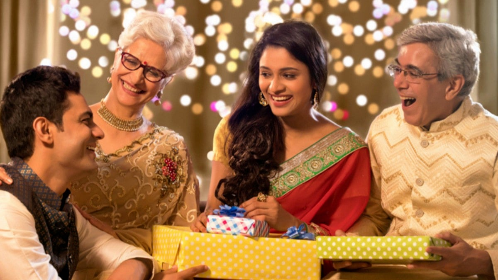

# The importance of setting the right boundaries in every woman’s life

## Let me tell you how women should handle such situations and the right definition of pativrata dharma.

*By Acharya Upendra Ji · 2023-04-23T07:00:00+05:30 · Source: https://www.freepressjournal.in/spirituality/the-importance-of-setting-the-right-boundaries-in-every-womans-life*

In the previous article, you understood the righteous duties of a wife (pativrata dharma). When she performs her duties correctly, she gets true happiness in life. You also learnt the importance of attracting the right life partner who has divine qualities like courage, bravery, good leadership, confidence, physical strength, etc.

However, today, many women face a lot of problems in their married life like physical and mental harassment, loss of freedom, financial dependency, etc, because they have not attracted the right life partner. Now, in such challenging situations tolerating all of this quietly is not the real definition of pativrata dharma.

Let me tell you how women should handle such situations and the right definition of pativrata dharma.

After a new marriage, the first two years are an observation period for the husband, wife and in-laws. As a new bride, whatever image you portray and create about yourself in terms of behaviour, interactions, handling situations, etc. remains for a lifetime.

> **Read Also:** [Do you know that the real purpose of Jagran is to awaken you to your true self?](https://www.freepressjournal.in/spirituality/do-you-know-that-the-real-purpose-of-jagran-is-to-awaken-you-to-your-true-self)

Hence, it is important for women to politely set their expectations and boundaries from day one. Ideally, right before the marriage is fixed, you must honestly speak about yourself, your expectations, limitations, etc.

Setting the right expectations doesn’t mean you have to be rude. Instead, it is about expressing your abilities, likes/ dislikes, upbringing, priorities, goals, etc, so that your life partner understands you better and respects your expectations and limitations. When you set your boundaries beforehand, your life partner won’t cross them easily.

But, as a woman, even after giving your best and doing your righteous duties, if you are still facing disrespect and harassment, then you have all the rights to use — Saam (resolve through peaceful discussion) or Daam (resolve through penalty) or Dand (punishment) or Bhed (permanent division) in the same order. You should not tolerate any kind of harassment or abuse after a certain limit. You should firmly make your husband and in-laws realise their incorrect behaviour towards you and let them know clearly that you are not going to tolerate it. You should protect your self-esteem (atma samman) in all situations.

In most cases, to save your marriage and the social image of your family, you let go and keep tolerating the harassment. This affects your self-confidence and you start feeling that you are worthless. If you have children, it becomes even more difficult for you to take bold decisions about separating from your husband. You fear that you, on your own, won’t be able to take responsibility of your children. It is unfortunate that divorced women receive differential treatment in society and are not respected even at their own parent’s house. Hence you choose to keep suffering rather than taking a bold step and keep regretting your entire life for not making the right decisions at the right time.

> **Read Also:** [These 7 divine qualities are naturally present in women, but they are not aware of it](https://www.freepressjournal.in/spirituality/these-7-divine-qualities-are-naturally-present-in-women-but-they-are-not-aware-of-it)

When you accept the unreasonable demands of your in-laws, they take you for granted and their demands keep on rising. Your suffering builds into deep resentment which leads to many health issues such as thyroid, knee pain, gynaecological problems, cancer, etc, at an early age.

It goes without saying that women deserve the utmost respect. Manusmriti 3.56 quotes — यत्र नार्यस्तु पूज्यन्ते रमन्ते तत्र देवताः, meaning — ‘where women are honoured, there the gods rejoice’. But for this, even women need to know their real worth, respect themselves first and set their boundaries. You should not let anyone cross your boundaries.

> **Read Also:** [Significance of a perfect life partner in every woman’s life](https://www.freepressjournal.in/spirituality/significance-of-a-perfect-life-partner-in-every-womans-life)

But, remember, you should not take any action or decision impulsively. Bhagavad Gita 2.14 mentions that one must first learn to tolerate. Among all other qualities, pativrata has three important qualities: tolerance, forgiveness and total surrender. She has the tolerance capacity. But you have to tolerate and forgive only up to a certain limit. So initially you need to be patient and see if the situation resolves. You also need to contemplate why such a situation has come into your life. Even after contemplating if you don’t get the right answers then you should go to a Jeevit Guru for further guidance. He will help you see and understand what went wrong. He will make you capable of rightly evaluating the situation and then making a wise decision. You may not know what is best for you, but as a Guru is a visionary he will know what lies ahead for you and will always guide you accordingly. You should completely surrender to him, and sincerely follow his guidance.

Meera Bai too suffered from a bad marriage. She also sought her Guru’s advice. Upon the advice of her Guru, she was able to take a strong decision to leave her in-laws’ home. She proceeded further for a higher cause. Today, Meera Bai is immortal and not her in-laws.

For women to get the right respect and status in society, it is crucial that the parents understand their major role in the upbringing of their young daughters.

In the next article, we will learn more about the key role of parents as well as the in-laws of a woman to have a successful married life. Stay tuned!

**(The writer is a spiritual leader and the founder of Antar Yog Foundation. To know more about the foundation, visit https://learn.antaryog foundation.in)**

> **Read Also:** [The art of leading a virtuous life that every woman must know](https://www.freepressjournal.in/spirituality/the-art-of-leading-a-virtuous-life-that-every-woman-must-know)
