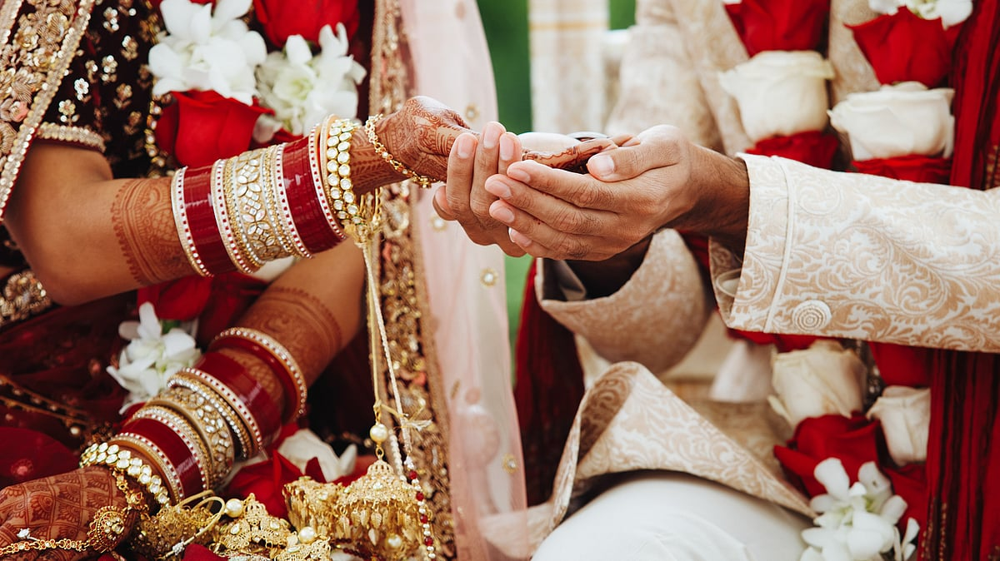

# The role of in-laws in the successful married life of a woman

## For several years, Saas-Bahu has been one of the most favourite topics of our television world

*By Acharya Upendra Ji · 2023-05-28T07:00:00+05:30 · Source: https://www.freepressjournal.in/spirituality/the-role-of-in-laws-in-the-successful-married-life-of-a-woman*

For several years, Saas-Bahu has been one of the most favourite topics of our television world. It is a ‘story’ generally seen in most ‘homes’, hence you all find it relatable. Daily soaps, movies, etc. are nothing but a reflection of true events happening in society. If this topic is so popular, then it is needless to say that in-laws must be playing a vital role in the successful marriage of a woman as she nearly spends 45-50 years of her life with her in-laws. Let me tell you how.

As per our scriptures, Devi Lakshmi comes to your home in three forms — as a daughter, a mother and a daughter-in-law. You must welcome your daughter-in-law with love as a form of Devi Lakshmi. You should take every effort to make her feel comfortable as she will be new to your home. You should patiently help her understand your traditions and guide her in the first two years of her Grihastha ashram (householder).

It is commonly seen that most in-laws expect their daughters-in-law to treat them as their own parents, but may not equally treat daughters-in-law as their own daughters and they consider them as outsiders. As per tradition, a woman has to change her middle name, last name and in some cases her first name as well after marriage to take her husband’s name and surname. Despite all this and serving the in-laws for her whole life, it is a reality that ancestral property is given to the son and not to the daughter-in-law most of the time.

In most families, it is seen that the career of the daughter-in-law is considered secondary while the career of the son is given primary importance. It will be inappropriate if you expect her to only stay at home, raise children and give up her career. The new bride who has come to your home is your bahurani and not your naukrani (domestic maid). Her purpose is not just doing your seva or your household chores. You should support her aspirations. At the same time, the daughter-in-law must realise that she cannot just be career-oriented. Ideally, she should be able to balance her profession and household duties.

> **Read Also:** [Key role of parents in the successful marriage of a woman](https://www.freepressjournal.in/spirituality/key-role-of-parents-in-the-successful-marriage-of-a-woman)

You must always remember that your daughter-in-law was born and brought up for 25-30 years of her life in a completely different environment. It can never be the same as your home. When she is new, she will need your support. Treating her disrespectfully or torturing her can start the downfall of your entire family. If you trouble her, how can she bear extraordinary grandchildren for you?

Imagine you uproot a fully grown tree and bring it to your courtyard. Now you need to take extra care of the tree so it does not perish. It needs to settle properly in your new environment. The same tree can give you fruits when it thrives happily.

Therefore, as in-laws, you must be patient and educate her about your traditions but do not force them on her. You should appreciate if she does anything good and must be open to understanding any ideal traditions that she was raised with. Being the elders at home, your daughter-in-law may notice your behaviour and tend to adopt the same.

At the same time, you must ensure that your son has in fact chosen a girl like Devi Lakshmi. It does not necessarily mean she should be rich but should have divine qualities and good sanskar like compassion, forgiveness, respect for elders, etc. for you and your family to prosper. You should see if the social status, kul (community) of both families, kundali (birth chart) and inner qualities of the girl and the boy match. Our scriptures like Chanakya Niti mention that when these aspects match, the chances of conflicts arising between the in-laws and daughter-in-law reduce.  Even today it is seen that most, including educated women, lose their freedom after marriage.

> **Read Also:** [The importance of setting the right boundaries in every woman’s life](https://www.freepressjournal.in/spirituality/the-importance-of-setting-the-right-boundaries-in-every-womans-life)

Our scriptures say that after you have grandchildren, you should not interfere much in the lives of your sons and daughters-in-law and should enter the Vanaprastha ashram. Vanaprastha doesn’t mean that you have to physically leave your home, it means you retire from your duties, guide the younger generation and live with detachment. You can give your opinion but should not enforce it. You should be content and happy with the way the younger generation runs the affairs of the home. At the same time, the younger generation should understand the importance of family traditions and respect the elder’s opinions.

As in-laws, when you choose the right daughter-in-law with divine qualities you wouldn’t have to worry about being alone at old age. At the same time, you must also learn about your righteous duties as in-laws from a realised spiritual Jeevit Guru. Only a Jeevit Guru can teach you the righteous way of living your life.

I hope now you have realised your ideal role as in-laws. In the next article, we will focus on the ideal education for women, how they can steadfast the progress of our country and how Bhartiya Nari is ideal for the entire world. Stay tuned!

> **Read Also:** [Significance of a perfect life partner in every woman’s life](https://www.freepressjournal.in/spirituality/significance-of-a-perfect-life-partner-in-every-womans-life)
