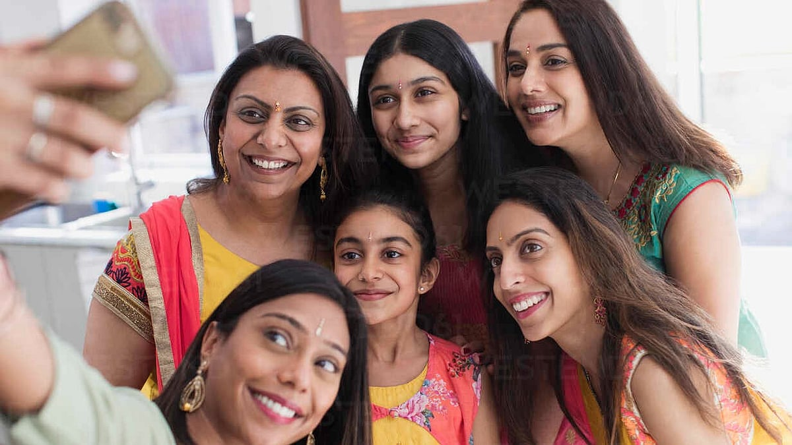

# These 7 divine qualities are naturally present in women, but they are not aware of it

## Women are the backbone of society. Since ancient times, they have played a significant role in transforming society

*By Acharya Upendra Ji · 2023-03-12T07:00:00+05:30 · Source: https://www.freepressjournal.in/spirituality/these-7-divine-qualities-are-naturally-present-in-women-but-they-are-not-aware-of-it*

Women are the backbone of society. Since ancient times, they have played a significant role in transforming society. Today women have touched great heights and are successful in almost every field. But despite so much progress women are still fighting for their rights, respect, freedom, pay scale, etc. Men still cannot digest and appreciate if their wives earn more income than them. People devoutly worship Mahalakshmi Devi, Durga Devi and celebrate Diwali and Navratri grandly but disrespect and sometimes even harass the same Devi who comes in the form of their wife, daughter-in-law, colleague or a stranger walking on the street. In a country like India, everyone wants Lakshmi Devi in the form of wealth, but the same Devi is rejected when she comes in the form of a girl child. Even today, many people are unhappy when a daughter is born and the wives are blamed for that. Women still cannot raise their voice against injustice and harassment due to fear.

Today, women are choosing incorrect ways to prove their identity and express their freedom. This is not how a Bhartiya nari was. Our Bhartiya scriptures hold the highest place for a woman. They don’t mention that women are equal to men, in fact, they say women are 1000 times more powerful than men. But the current situation in society that we are seeing is exactly the opposite.

Let me tell you why. These are the alarming repercussions of women not learning Vedant. Vedant is the highest spiritual knowledge that frees you from all your problems and leads you to your true Self. As a woman, not learning Vedant leads to your downfall, the downfall of your family and the entire nation. Whether you are single or married, daughter, wife, mother, sister, friend, mother-in-law, etc. you need to understand your dharma (righteous duties) as per the scriptures. When you don’t understand your dharma, you make wrong choices in life, and hence suffer.

The only way women can end their suffering and change this plight of our society is when they realise their own value. It is only possible by learning Vedant from a spiritually realised Jeevit Guru. Only a Guru can make you realise your true form - that you are the same Parvati or Lakshmi or Durga Devi you worship in temples. A Devi is identified as someone who has all the divine qualities in abundance. As mentioned in the Bhagavad Gita, 10.34, the true beauty of a woman is seen through these divine qualities:

> **Read Also:** [Do you meet people by coincidence or for a reason? The science behind runanubandh](https://www.freepressjournal.in/spirituality/do-you-meet-people-by-coincidence-or-for-a-reason-the-science-behind-runanubandh)

Keerti (Legendary Status): This is perpetual fame where the person touches the soul of the masses. For example, Jija Mata is still immortal in our history and our thoughts due to her valour and values. Today’s women should draw inspiration from such great women and become legendary, not just famous.

Shree (Auspiciousness): Shree refers to daivi sampatti (divine wealth) which consists of qualities like being spiritual, knowledgeable, courageous, loving, etc. As a woman, you need to awaken this divine wealth for the benefit of the entire society.

Vak (Divine speech): Women have the ability to perfectly gauge a situation and the right time to be strict or soft. But this comes with Vivek buddhi (the power of discrimination between right and wrong) and balanced mind which is quietened with the knowledge of Vedant.

Smriti (Memory): Women are blessed with a sharp memory. For example, a woman will  remember the exact words her sister-in-law used in a fight which might have happened 20 years ago. But instead this quality needs to be utilised to grasp and remember the knowledge of our scriptures.

Medha (Divine Recollection): Women have been blessed with Medha Shakti to learn and recollect the knowledge of Vedant. But they use it to recollect unwanted incidents. If you ask them about a certain incident from the past, they will easily tell you with all minute details. But storing and recollecting such junk data is not useful for her progress.

Dhriti (The ability to hold on to subtle things for a long time): We usually observe that women hold onto a grudge, a complaint against someone for a long time. Instead, women should see good qualities in others, let go of grudges and complaints and hold on to the good things in life.

> **Read Also:** [Do you know that the real purpose of Jagran is to awaken you to your true self?](https://www.freepressjournal.in/spirituality/do-you-know-that-the-real-purpose-of-jagran-is-to-awaken-you-to-your-true-self)

Kshama (Forgiveness): A woman needs to wisely judge where, how and whom to forgive. The person should be supatra (worthy) of forgiveness. Evil needs to be fought with dand (punishment) and not daya (mercy). Devi does not forgive Mahishasur. She kills him, but she does it for his own good. Women easily forgive the wrongdoings of their husbands, in-laws, children, etc. due to fear or moh (attachment) and then suffer. After saam and daam, dand (punishment) needs to be given, regardless of what relation you have with that person. This understanding comes when you learn Vedant from a Jeevit Guru.

These divine qualities are naturally present in a woman but today she herself is unaware of her divinity. That is why women, the very embodiment of Shakti (power), have become submissive, powerless and still need to fight for everything in today’s times. Because, unfortunately, our Indian women have only forgotten our Bhartiya culture.

Women, when will you realise that you are more powerful than men? Its time to awaken your true power! In the next article of this series, I will further reveal how you play a key role and have the power of changing and uplifting the entire Nation! Stay tuned.

> **Read Also:** [Do you know the true purpose of prayer? Understanding the art and science of prayer](https://www.freepressjournal.in/spirituality/do-you-know-the-true-purpose-of-prayer-understanding-the-art-and-science-of-prayer)
