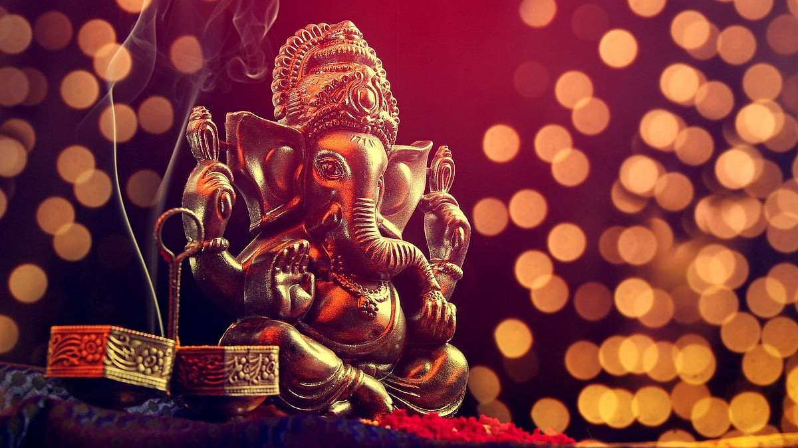

# Why do people worship symbols or photos? Tracing the origin of idol worship

## The origin of idol worship can be traced back to early humans who started with ancestral worship (pitru puja) and nature worship (prakruti puja)

*By Acharya Upendra Ji · 2022-08-28T07:00:00+05:30 · Source: https://www.freepressjournal.in/spirituality/why-do-people-worship-symbols-or-photos-tracing-the-origin-of-idol-worship*

Bharat is known to be a land which celebrates numerous festivals throughout the year with great enthusiasm! During these festivals, every home, street and lane of the country turns divine with devotees worshipping their beloved deity’s idol with utmost devotion. You must have wondered why there are so many deities. Why do people worship symbols or photos? Some of you could be feeling that why should you worship God in the first place? Since this is a vast topic, we will cover it in a series of articles where you will learn about the origin, history, science, social message and the spiritual significance behind idol worship and much more. So let’s begin.

The origin of idol worship can be traced back to early humans who started with ancestral worship (pitru puja) and nature worship (prakruti puja). When they witnessed the death of a near-one for the first time, they could not understand where that person went and hence prayed for the well-being of the person assuming he is still around somewhere. This ancestral worship was observed across the world. The Egyptians used to make a mummy of the body of the person who passed away for the same reason.

Similarly, they noticed different qualities of the earth, the sea, the sun, the trees, etc. The disciplined sun rose from the east and set in the west every day at specific times, on its own without fail. They noticed the selfless giving nature of the trees and mother earth. They realised something higher than them is at work and started worshipping these qualities of nature. Lord Datta’s 24 Gurus is a classic example where he learnt different qualities from nature and attained enlightenment through it.

Thus, humans started worshipping and making offerings to express their gratitude to nature which are known today as stutis and pujas. That time they had pure intentions and did it out of utmost respect and love.

But, the early humans started facing limitations in their nature worship. They could not visit the sea every time or did not find the sun in the sky at night to worship. This gave birth to the concept of idols and symbols.

Our God-realised Saints created the idols and symbols that you worship today, with great thought. As per scriptures, ‘Sadhakanam Hitatrtham Brahmani Roop Kalpate’; for the common man who had never seen God and did not know much about him, our Saints, developed these forms which symbolise every quality and power that God possesses, making it the first step of devotion towards God. This is how the infinite and formless God (Nirakar) was represented through the finite (Sakar) form.

To explain you with an example, the flag of your country is made from coloured cloth, rod and rope. Now is the flag by itself your nation? No. Then what makes you treat the same piece of cloth, rod and rope with utmost respect and care? Why do you get angry when anyone insults that flag which is nothing but a combination of cloth, rod or rope? It is because it symbolises your nation and your emotions of patriotism are attached to it.

Likewise, you may always carry a photograph of your mother with you. A photograph is made just from photo ink and paper. Yet, what makes you keep it with great love and care? How do you get relief when you take your heart out in front of that photo? Will you throw it away in the garbage? The photo itself is not your mother, yet you are emotionally attached to it and it symbolises your mother.

Similarly, the idols, photos, yantras, symbols, etc. are a symbolic form of the multiple qualities that the formless God possesses, to which your emotions, faith and devotion are attached.

Our great saints knew that the human mind needs some finite form to focus. They knew that the early students would find it difficult to understand the formless, infinite God who is present everywhere but can not be seen. Since humans are sakar form (manifested), they also need some sakar form for worship. Now you must have understood why the almighty is represented by some symbol, some finite form in every religion. This is the origin of idol or symbol worship!

Now, every time you see an idol or a symbol, will you be reminded of the divine qualities that you need to possess to lead an extraordinary life?

I hope you have understood the deep thoughts of our great saints behind idol worship. In the subsequent articles of this series, I shall be revealing deep insights about the history of idol worship, the untold reason behind multiple forms of the Gods, the science behind idol worship and much more. Stay tuned!

**(The writer is a spiritual leader and the founder of Antar Yog Foundation. To know more about the foundation, visit https://learn.antaryogfoundation.in)**
