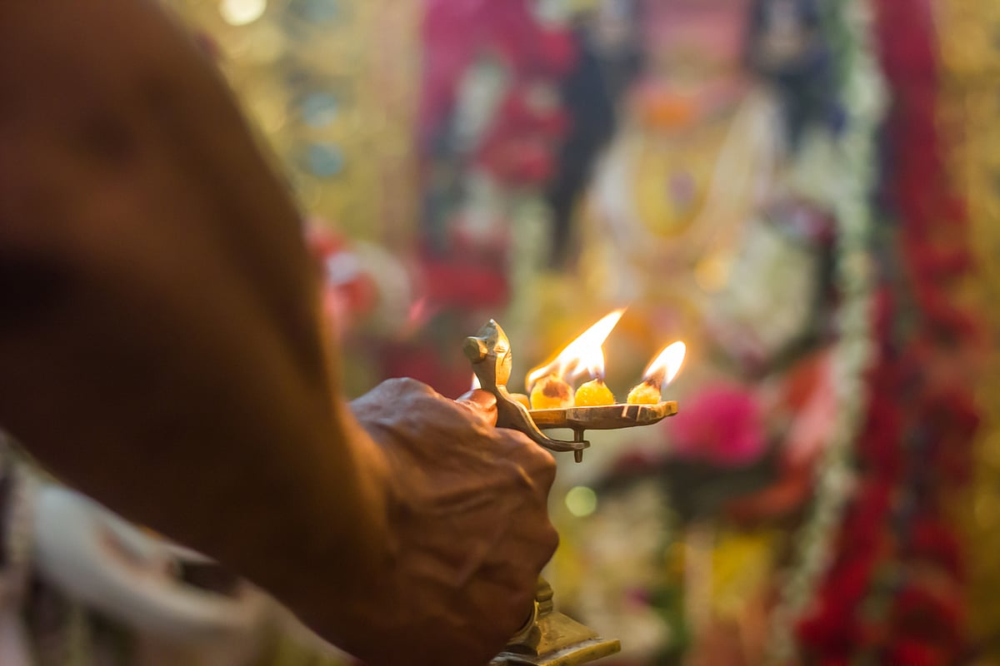

# Why multiple forms of God were designed and their deep significance as per our scriptures

## The various forms of God i.e deities that we know represent the unique and specific quality or power of the same supreme, formless (nirakar) God

*By Acharya Upendra Ji · 2022-09-11T07:00:00+05:30 · Source: https://www.freepressjournal.in/spirituality/why-multiple-forms-of-god-were-designed-and-their-deep-significance-as-per-our-scriptures*

In the previous article of this series, you learnt about the origin of idol worship and the idea behind introducing idols, symbols, photos, yantras, etc. In this article, let us take a look at why multiple forms of God were designed and their deep significance as per our scriptures.

Let us start with an example. You are under the governance of one King. Some of you may have security-related problems, health problems, or business-related problems. If all of you approach him for a solution, it will create chaos and the King will find it difficult to resolve every problem on his own. Hence, he needs a cabinet of ministers, each specialising and handling a different department dedicated to different aspects of defence, health, finance, commerce, etc. People with financial issues can directly approach the finance department. So when all people with similar problems go to a specific department, it becomes easier to give solutions to them in the least possible time. This entire administrative system of the King is inspired from the same concept of multiple forms of God.

> **Read Also:** [Why do people worship symbols or photos? Tracing the origin of idol worship](https://www.freepressjournal.in/spirituality/why-do-people-worship-symbols-or-photos-tracing-the-origin-of-idol-worship)

The various forms of God i.e deities that we know represent the unique and specific quality or power of the same supreme, formless (nirakar) God. For instance, Lord Ganesha is worshipped for wisdom and leadership, Lord Shiva for detachment (vairagya) and healing, Lord Hanuman for devotion and strength, Lord Vishnu for management and maintenance, Goddess Lakshmi for wealth. Each deity serves a different purpose and appeals to the individual based on his current problems, needs, likes, etc.

People who have financial issues will visit the temple of Goddess Lakshmi where hymns like Shree Sukta will be chanted by the priests. People with health problems will go to the temple of Lord Shiva where the powerful Maha Mrutyunjaya mantra has been chanted for centuries. Those suffering due to Shani Sade Sati will go to the Shani temple, and so on. When people with similar problems come to pray in a temple, the remedies performed and prayers recited create collective energy. The temples are also visited by realised Saints and Gurus who energise the temple and its surroundings.

> **Read Also:** [Why do good people suffer? Here's why](https://www.freepressjournal.in/spirituality/why-do-good-people-suffer-heres-why)

This divine energy generated in the temples largely benefits the people who visit there. Also, when like-minded people with similar problems meet they relate to each other’s problems. When you see others facing the same issues as yours, you don’t feel alone. In fact, you get the strength to tackle them. This was the main idea behind creating various forms of the same God and temples dedicated to different forms of God.

But you should not just stick to one form or worship any form of God as you wish. If you want to renounce worldly life, worshipping Goddess Durga may instead bless you with power, wealth and wisdom! The right choice here would be worshipping Lord Shiva. Even if you go to the wrong department, some Jivit Guru will come and redirect you to the right department as per your current problems.

> **Read Also:** [Guru Gyan: Who is a real Guru?](https://www.freepressjournal.in/spirituality/guru-gyan-who-is-a-real-guru)

Do you know why women or men are not allowed in certain temples? Let me explain this with a simple example. In public places, separate toilets are created for ladies and gents, for the sake of privacy and safety. Technically, they are just rooms with facilities. Will it make sense if women protest to use the men’s toilet, thinking it is their right? Similarly, in a train, there are separate compartments for ladies and gents for comfort and safety. Again, they are just compartments of the same train. Yet, men are not allowed there.

Similarly, certain temples emit energies which may not be favourable for men or women. God has not created any rules, they have been made by our Saints for your benefit and a higher purpose.

> **Read Also:** [FPJ Anniversary 2022: Bharat’s future and your big role in it](https://www.freepressjournal.in/spirituality/fpj-anniversary-2022-bharats-future-and-your-big-role-in-it)

The circumstances in your life take you to the right deity. Tomorrow you may lose your job or face a challenge in your business and have financial troubles. Worshipping Goddess Lakshmi at that point will help you overcome it. Hence, you cannot complain why a follower of Lord Vishnu does not worship or follow Lord Shiva. If you worship your favourite Lord Ganpati, it doesn’t mean you can force others to worship him only. Your Lord Shiva, Ganpati, Lakshmi, etc. are various forms of the same God.

Just because your body is one, you can’t eat food with your ears, you have to eat with your mouth only. Your body has different organs for different functions, similarly, deities have different powers but are forms of the same God.

Once you get the knowledge of the formless God and accept that God is one and all-pervading, you can worship any form of God. There is no bondage at this high level of devotion.

So, what about the 33 Koti Devtas that Hindus have? Do 33 Koti forms of God exist? To learn, stay tuned to the next article of the series!

**(The writer is a spiritual leader and the founder of Antar Yog Foundation. To know more about the foundation, visit https://learn.antaryog foundation.in)**

> **Read Also:** [Guru Purnima special: Why do you need a Guru?](https://www.freepressjournal.in/spirituality/guru-purnima-special-why-do-you-need-a-guru)
